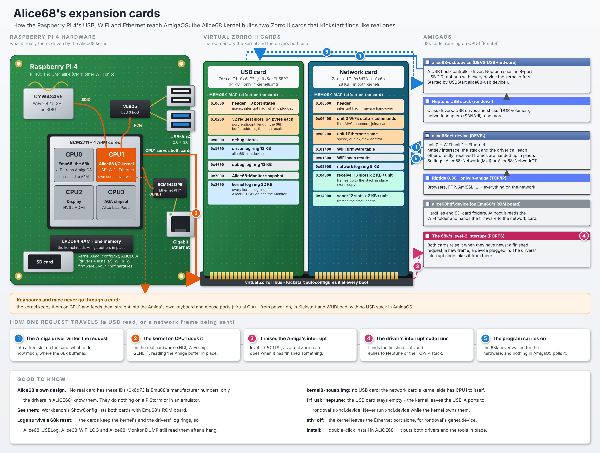

# Alice68

[](https://buymeacoffee.com/farsonic)

**A standalone AGA machine on a Raspberry Pi 4 (Pi 400 and CM4 untested): Workbench
and AGA software on a local HDMI display, with no PiStorm and no motherboard.**

Downloads: [Releases](https://github.com/farsonic/Alice68/releases) ·
What's new: [RELEASE-NOTES.md](RELEASE-NOTES.md) ·
Maintaining it with Claude: [docs/USING-CLAUDE.md](docs/USING-CLAUDE.md)

Alice68 is named after Alice, the AGA chip that succeeded Agnus, and the 68k that
Emu68 runs. It is a Pi 4 build of three projects, plus a Pi 4 USB stack of its own:

- **[Emu68](https://github.com/michalsc/Emu68)** by Michal Schulz: the 68k JIT
  (1.1.0-beta.1).
- **[AGA-PiStorm](https://astair86.itch.io/aga-pistorm-10-experimental-prototype)**
  1.120 by Astair86: the virtual Alice/Lisa/Paula, Copper and blitter, with output
  through the VideoCore VI and sound over HDMI.
- **[EMU68AGA Bare Metal](https://github.com/futureretrofusion/EMU68AGA-Bare-Metal)**
  by Future Retro Fusion: the standalone layer (virtual CIAs, ROM and ADF boot,
  Zorro III RAM, a TinyUSB host on the USB-C port).
- **Alice68's own additions:**
  - two **virtual Zorro II expansion cards** that AmigaOS finds like real ones (see
    [Alice68's expansion cards](#alice68s-expansion-cards)): a **USB card**, through which
    the kernel's own Pi 4 USB driver hands devices to the Neptune USB stack, and a
    **network card** for the Pi's built-in **WiFi** and **Gigabit Ethernet**;
  - USB keyboards and mice on the Pi's USB-A ports from power-on, and a "virtual eject"
    for USB network dongles that start in CD mode;
  - Amiga hardfiles (`.hdf`) straight from the SD card, bootable and writable, and SD-card
    folders as Amiga volumes;
  - a boot splash with live logs.

Credits and licences: [THIRD_PARTY_NOTICES.md](THIRD_PARTY_NOTICES.md),
[LICENSE](LICENSE). Every Emu68 file that differs from upstream, who changed it and why:
[docs/EMU68-CHANGES.md](docs/EMU68-CHANGES.md).

**Alice68 is an independent project.** It is not part of Emu68, and it is not endorsed
by Emu68's author. Joining Emu68 to a virtual AGA chipset on a bare Pi 4 is the work of
AGA-PiStorm, FRF and Alice68, and the Pi 4 USB and network drivers and the Amiga drivers
are Alice68's; Emu68's author has no part in any of it. The kernel calls itself Alice68, "based on Emu68"; it
keeps Emu68's `/emu68` device-tree entry only because Amiga drivers written for Emu68
look for it. **Report Alice68 problems here, not to Emu68 or the other upstream
projects.**

> **Status:** tested on a Raspberry Pi 4. It boots to Workbench at 1080p. A USB-A
> keyboard and mouse work from power-on. A Realtek RTL8156 network adapter on Neptune
> passed traffic at about 108 Mbit/s. Hardfiles on the SD card mount, boot and take
> writes; SD-card folders mount and take writes; the kernel's Ethernet (unit 1 of the
> network card) runs at about 92 Mbit/s on a 100 Mbit/s switch port; the splash's
> animation runs. Treat everything else (WiFi included) as experimental.

## Quick start

1. Take a microSD card with a **FAT32** first partition (any Raspberry Pi OS card, or
   one formatted on a PC).
2. Copy the **Raspberry Pi firmware** onto it: `start4.elf`, `fixup4.dat` and
   `bcm2711-rpi-4-b.dtb` (`-400` for a Pi 400) from
   [raspberrypi/firmware](https://github.com/raspberrypi/firmware/tree/master/boot).
3. Unzip the release and copy **everything in it** onto the card's root: `kernel8.img`,
   `kernel8-nousb.img`, `config.txt`, `cmdline.txt`, `floppy.txt`, the `overlays` folder
   and the `ALICE68` folder (Alice68's Amiga files, their installer, the read-mes and the
   licences, which AmigaOS sees as the volume `ALICE68:`; see
   [Folders](#folders-of-the-sd-card-as-amiga-volumes)). It replaces `config.txt`,
   `cmdline.txt` and `floppy.txt`: keep your own if you changed them.
4. Copy **your own** 512 KB A1200 Kickstart 3.x ROM onto it as **`kick31.rom`**, or
   change the name in `floppy.txt`. Kickstart is not included.
5. Plug a USB keyboard and mouse into the Pi's USB-A ports, connect HDMI0 (next to the
   USB-C power socket), and power on.

You get Kickstart's insert-disk screen. To get a Workbench, either put a hardfile on the
card (see [Hardfiles](#hardfiles-hdf-on-the-sd-card)), boot an ADF (see
[floppy.txt](#floppytxt-kickstart-and-adf)), or use Amiga partitions (MBR type `0x76`),
as with any Emu68 card.

The files in `boot/` work as they are. The next three sections explain what's in them
and what you can change.

## config.txt

The Raspberry Pi firmware reads `config.txt`. The default one, part by part:

```ini
[all]
kernel=kernel8.img        # Alice68
arm_64bit=1
disable_splash=1          # no rainbow screen
avoid_warnings=1
enable_uart=1
```
Leave these as they are.

**Display.** Alice68 uses **HDMI0**, the port next to the USB-C power socket.

```ini
hdmi_force_hotplug=1      # output even if the screen is detected late
hdmi_drive=2              # HDMI with sound (Paula is played over HDMI)
hdmi_group=1              # TV modes (CEA)
hdmi_mode=31              # 1080p50
```

| `hdmi_mode` | Picture |
|---|---|
| `31` | 1920×1080, 50 Hz (default: a PAL screen scales cleanly, Workbench text is sharp) |
| `16` | 1920×1080, 60 Hz |
| `19` | 1280×720, 50 Hz (if your screen prefers 720p) |
| `4` | 1280×720, 60 Hz |

Example: a 720p TV
```ini
hdmi_mode=19
```

**Kickstart.** It is named in its own file, so you can swap it without touching
`config.txt`:

```ini
include floppy.txt
```

**SD card for AmigaOS.** Emu68's `brcm-emmc.device` gives AmigaOS the card's Amiga
partitions (MBR type `0x76`, one drive each).

```ini
dtoverlay=emmc,unit0=rw
```

`unit0` is the **whole card**. Alice68's hardfile driver needs it, and it decides what
the hardfile driver may do:

| Setting | Effect |
|---|---|
| `dtoverlay=emmc,unit0=rw` | Hardfiles readable and writable (default) |
| `dtoverlay=emmc,unit0=ro` | Hardfiles read-only |
| `dtoverlay=emmc,unit0=off` | No hardfiles |
| `dtoverlay=emmc,unit0=rw,low_speed` | As the default, at 25 MHz: use this if your card gives errors (PFS3 reporting bad blocks, say) |

**Diagnostics (optional).** Emu68's on-screen HUD, off by default:

```ini
dtoverlay=diagnostic,hud
```

## floppy.txt: Kickstart and ADF

```ini
initramfs kick31.rom followkernel
```

The file name must match your ROM exactly, including case. Without a ROM the splash
stops with `FAIL: NO KICKSTART ROM LOADED`.

**Booting an ADF.** Join the ROM and a floppy image into one file on a PC, then name
that file here:

```bash
cat kick31.rom game.adf > kickadf.rom
```
(Windows: `copy /b kick31.rom+game.adf kickadf.rom`)

```ini
initramfs kickadf.rom followkernel
```

## cmdline.txt: Alice68's options

Everything goes on **one line**, separated by spaces. The default is:

```
aga.look=0 aga.scale=1
```

| Option | What it does |
|---|---|
| `aga.look=0` / `1` / `2` | Picture: sharp (default) / smooth / TV |
| `aga.scale=0` … `7` | Scaling: 0 4:3, 1 integer (default), 2 fill, 3 5:4, 4 16:9, 5 16:10, 6 21:9, 7 32:9 |
| `aga.nobootlog` | No log panels on the boot splash |
| `hdf.boot=NAME` | Boot from the hardfile `NAME` (see [Hardfiles](#hardfiles-hdf-on-the-sd-card)) |
| `hdf.readonly` | Hardfiles read-only |
| `hdf=off` | No hardfiles |
| `iso=off` | No CD images (see [CD images](#cd-images-iso-on-the-sd-card)) |
| `frf_usb=neptune` | Leave the USB-A ports to AmigaOS (rondoval's `xhci.device` + Neptune) instead of the kernel; the USB-C port then takes keyboard, mouse and pads (untested on a Pi 4) |
| `frf_usb.nomodeswitch` | Don't switch Realtek USB network dongles out of driver-CD mode |
| `wifi.ssid="NAME"` `wifi.psk="PASSWORD"` | Join this WiFi network at boot (see [WiFi](#wifi-new-not-yet-tested-on-a-pi)) |
| `wifi.country=GB` | Your country: the WiFi channels allowed |
| `wifi=off` | Leave the WiFi chip off |
| `eth=on` | Start the kernel's Ethernet at boot (it also starts when a stack opens `alice68net.device` unit 1) |
| `eth=off` | Keep the kernel off the Ethernet port (for rondoval's `genet.device`) |
| `net.oui=off` | Keep the Pi's own MAC addresses (otherwise both network units use Commodore's OUI, `00:80:10`) |
| `net.trace=1` | Log every ICMP (ping) frame and the first dropped frames to the network log (Alice68-Monitor DUMP), kernel and alice68net.device |

Examples:

```
aga.look=0 aga.scale=1 hdf.boot=Workbench
```
boots from `Workbench.hdf`, with the default picture.

```
aga.look=2 aga.scale=0
```
gives a TV look, 4:3.

AGA-PiStorm's Chipset menu (`agaboot`) changes the picture at run time as well.

## The boot splash


The splash has five parts:

- **Header:** the Alice68 emblem and versions.
- **Status strip:** video, ROM, 68k, CPU1, USB, the input devices found, the
  hardfiles (how many boot, how many are mounted without booting, and how many were left
  out, in amber, with the reason in the SYSTEM panel) and the WiFi (connected, joining,
  no firmware, ...).
- **SYSTEM panel:** the kernel log.
- **USB panel:** the USB log.
- **Credits line.**

Failures show in red, so a photo of the screen is usually enough to diagnose a hang.
The splash keeps updating after the 68k starts - the hardfiles and the WiFi come in
then - and stops when AmigaOS puts its first picture up (or 30 s after the 68k started,
for a Workbench that opens straight on RTG), so nothing is drawn over AmigaOS's screen. `aga.nobootlog` in
`cmdline.txt` turns the log panels off. `tools/splash-preview/build.sh` renders the
splash on a PC with the kernel's own drawing code.

## Alice68's expansion cards

A real Amiga gets USB or networking from a card in a Zorro slot. Alice68 has no slots,
so its kernel **makes the cards up**: when the Amiga starts, Kickstart's expansion
setup (autoconfig) finds them on a virtual Zorro II bus and gives each an address, as
it would a real card. AmigaOS's drivers then talk to them the way drivers talk to any
Zorro card, through the card's memory and its interrupt.

What is on the card, though, is done by the **Raspberry Pi's own hardware**, driven by
the Alice68 kernel on CPU1 (the second ARM core), not by the 68k. The card is the
meeting point: the Amiga driver writes a request into the card's memory, the kernel
carries it out on the Pi's USB, WiFi or Ethernet hardware, writes the answer back and
raises the Amiga's level-2 (PORTS) interrupt, as a real card would. The 68k never
waits for the hardware.

[](docs/images/alice68-cards.png)

<details>
<summary>The same as text</summary>

```
       Raspberry Pi 4 hardware            Alice68 kernel             virtual Zorro II cards              AmigaOS (68k on CPU0)
     ---------------------------     ----------------------     ------------------------------     ------------------------------

     USB-A ports  (VL805 xHCI) --+                                +----------------------------+
                                 |                          +---> | USB card           64 KB   | <--> alice68-usb.device
                                 +--> xHCI driver  (CPU1) --+     | Zorro II 0x6d73/0x6a "USBP"|      (DEVS:USBHardware)
                                 |       |                  |     | requests, buffers, logs    |          ^
     keyboards and mice <--------+       |                  |     +----------------------------+          |
     go straight to the Amiga's          |                  |                                         Neptune USB stack:
     keyboard and mouse  <---------------+                  |                                         storage, network
     (virtual CIA, from power-on)                           |                                         adapters, ...
                                                            |
     WiFi (CYW43455, SDIO) ------+                          |     +----------------------------+
                                 +--> network   (CPU1) -----+---> | Network card      128 KB   | <--> alice68net.device
     Gigabit Ethernet (GENET) ---+    WiFi + Ethernet       |     | Zorro II 0x6d73/0x6b       |      unit 0 WiFi
                                                            |     | frames, state, settings,   |      unit 1 Ethernet
                                                            |     | scan results, logs         |          ^
                                                            |     +----------------------------+          |
                                                            |                                         Riptide or lwip-amiga
                                                            |                                         (netdev)
                                                            +---- level-2 (PORTS) interrupt ----> 68k: "a card has news"
```

</details>

| Card | Zorro II ID (manufacturer/product) | Size | AmigaOS driver | Done by the kernel | In |
|---|---|---|---|---|---|
| **USB card** | `0x6d73` / `0x6a` (106), serial "USBP" | 64 KB | `DEVS:USBHardware/alice68-usb.device`, for Neptune | the Pi 4's USB-A ports (xHCI on PCIe) | `kernel8.img` |
| **Network card** | `0x6d73` / `0x6b` (107) | 128 KB | `DEVS:alice68net.device`, units 0 and 1, for a netdev TCP/IP stack | WiFi (SDIO) and Gigabit Ethernet (GENET) | both kernels |
| Emu68's ROM board | `0x6d73` / `2` | - | holds `alice68hdf.device` (hardfiles, folders) and Emu68's own drivers | - | both kernels |

`0x6d73` is Emu68's manufacturer number. Workbench's `ShowConfig` lists the cards;
**`Alice68-ShowConfig`** (in `C:` after `ALICE68:Install`) says much more: the processor,
Kickstart, chipset and every memory region; each board's Zorro type, address, size,
serial, flags and driver, with names for Emu68's and Alice68's boards; and what is live on
Alice68's cards - the USB devices passed through and the request slots, both network
units' link, addresses, WiFi network, counters and queues, and `alice68hdf.device`'s
hardfiles and folders. `Alice68-ShowConfig ALL` adds the libraries, devices and resources
in memory and the end of the kernel's log; `SYS`, `MEM`, `BOARDS`, `CARDS`, `LIBS` and
`LOG` pick parts.
They are **Alice68's own design**: no real card has these IDs, and the drivers in
`ALICE68:` are the only ones that know them. They do nothing on a PiStorm or an
emulator.

What this gives:

- **No driver in AmigaOS touches the Pi's hardware**, so there's nothing for a 68k
  driver to get wrong or slow down: the kernel's drivers run on their own ARM core,
  beside the 68k, and keep running while AmigaOS reboots. Keyboards and mice are the
  kernel's from power-on, inside WHDLoad too, without any USB stack in AmigaOS.
- **The Amiga side is small and ordinary**: a USB host-controller driver Neptune
  already knows how to use (the classic `IOUsbHWReq` interface), and a network driver
  for the netdev interface. They are installed from `ALICE68:` like any other driver.
- **The logs survive a 68k reset**: both cards keep the kernel's and the drivers' log
  rings, which `Alice68-USBLog`, `Alice68-WiFi LOG` and `Alice68-Monitor` read even
  after a hang and a Ctrl-Amiga-Amiga.

The **no-USB kernel** (`kernel8-nousb.img`) has no USB card: the network card's
kernel side then has CPU1 to itself. With `frf_usb=neptune` in `cmdline.txt` the USB
card is still there but stays empty: the kernel leaves the USB-A ports to rondoval's
`xhci.device`.

## USB

| Port | Default | With `frf_usb=neptune` |
|---|---|---|
| **USB-A ×4** (and the Pi 400 keyboard) | **The Alice68 kernel:** keyboards and mice go straight to the Amiga's keyboard and mouse port, from power-on and inside WHDLoad. Every other device (storage, network) is passed to **Neptune** in AmigaOS. | AmigaOS: rondoval's `xhci.device` + Neptune |
| **USB-C** (power socket) | not used | FRF's TinyUSB host in the kernel: keyboards, mice, pads, `usbmass.device` (tested by FRF on a Pi 3, untested on a Pi 4) |

A CM4's USB port is the USB-C controller, so on a CM4 use `frf_usb=neptune` (untested).

### Neptune on the USB-A ports (storage, network)

The kernel keeps USB keyboards and mice for itself and offers every other device on the
[USB card](#alice68s-expansion-cards). To use them in AmigaOS:

1. Install [Neptune](https://github.com/rondoval/neptune-usb-stack) 6.3 or later. It
   needs no host-controller driver of its own here: **don't** use `xhci.device` while the
   kernel owns the USB-A ports, as the two cannot share the controller.
2. Install `alice68-usb.device` into `DEVS:USBHardware/`: double-click **Install** in
   `ALICE68:` (it also puts `Alice68-USBLog` in `C:`), or copy them by hand.
3. Start Neptune on it, from a Shell or at every boot in `S:User-Startup`:
   ```
   C:USBStart >NIL: alice68-usb.device 0
   ```
   or choose `alice68-usb.device`, unit 0, in **Neptune USB**. If Neptune's installer
   added a `USBStart` line for `xhci.device`, change it to this.

Neptune sees an 8-port USB 2.0 root hub, with every device the kernel doesn't keep for
itself on it. USB 3 devices work as USB 2.0. `Alice68-USBLog FOLLOW` tails the kernel's and
the driver's USB logs in a Shell.

- **Network adapters:** the Neptune class is the SANA-II driver. For `cdceth.usbclass`,
  give your TCP/IP stack `usbcdceth.device`, unit 0, as a bare name.
- **Virtual eject:** Realtek RTL815x adapters that start as a driver CD (`0bda:8151`)
  are switched to network mode by the kernel. `frf_usb.nomodeswitch` turns this off.
- **Leaving the USB-A ports to AmigaOS:** `frf_usb=neptune` in `cmdline.txt` keeps the
  kernel off them, so rondoval's `xhci.device` can drive them instead.

## WiFi and Ethernet: Alice68's network card (Ethernet tested on a Pi, WiFi still being tested)

The **kernel** runs the Pi 4's built-in WiFi (the Cypress CYW43455 chip) and its Gigabit
Ethernet port (GENET) on CPU1, beside USB, and AmigaOS sees one network card with two
units: `alice68net.device` **unit 0 is the WiFi, unit 1 the Ethernet**. The driver speaks
lwip-amiga's `netdev` interface, which is faster than SANA-II (the stack and the driver call
each other directly): rondoval's **lwip-amiga** (the
[driver stack](https://github.com/rondoval/emu68-driver-stack/releases)'s archives) and
**Riptide** (**0.38 or later**: earlier versions hang after the first ping with a driver
that reports sent frames as promptly as this one) can use it; Roadshow, AmiTCP and Miami (SANA-II
only) cannot. The WiFi chip's own firmware does the WPA2 handshake (and WPA3 where the
firmware supports it).

**`Alice68-Network`** (in `C:`, or drag it to `SYS:Prefs`) is the settings window, in MUI
(3.8 or later) and in the look of Riptide's preferences. Its pages:

- **About**, **Status** (both units and all traffic of the last minute);
- **Networks**: **Ethernet** (the link: rate, duplex, autonegotiation, what each side
  offers, flow control, link downs, time up, the MAC address) and **WiFi** (the connection,
  and the networks in range: Scan, then a click on one to join it);
- **Settings**: **Ethernet** (an on/off switch; autonegotiation and the speeds and duplexes
  to offer, or a fixed speed and duplex; flow control) and **WiFi** (an on/off switch;
  network name, password - dots unless Show is ticked -, country, Join and save,
  Disconnect, power saving);
- **Traffic**: **Ethernet** and **WiFi** (rates, bytes, packets, drops and errors in and out,
  and a graph of the last minute).

**The on/off switches** at the top of the two Settings pages switch a unit's hardware off
and on, also while a TCP/IP stack is using it: switched off, the stack sees the link go
down, nothing is sent or received, and it stays off - a stack starting, the WiFi's
automatic restart or new firmware do not switch it on again - until the switch is turned
on. On again, the WiFi rejoins its network and the Ethernet starts if a stack uses it.
The line beside each switch says what it means right now. **Save** keeps the switches'
positions for the next start (`UNIT0=OFF` / `UNIT1=OFF` in `alice68net.prefs`).

**Apply** gives the kernel the settings now; **Save** also keeps them for the next start
(the WiFi network in `ENVARC:alice68wifi.prefs`, the Ethernet and WiFi settings in
`ENVARC:alice68net.prefs`, which `alice68net.device` applies when it starts). Without MUI,
`Alice68-NetworkGT` is a simpler GadTools window.

**Commodore's MAC prefix.** Both units' MAC addresses start with Commodore International's
`00:80:10`; the last three bytes are the Pi's own. `net.oui=off` in `cmdline.txt` keeps the
Pi's addresses. (Your router sees a new machine the first time: a DHCP server may give it a
new address.)

### WiFi

1. **Firmware**, on the SD card's FAT partition (where `kick31.rom` is), in a folder
   named **`WIFI`**. Alice68 can't include it (it isn't ours to distribute). The `.bin`
   is the chip's firmware, the `.txt` the board's radio settings (both needed), the
   `.clm_blob` the regulatory data (which channels each country may use):

   | Board | Files |
   |---|---|
   | Pi 4 Model B, Pi 400 | `cyfmac43455-sdio-standard.bin`, `cyfmac43455-sdio.clm_blob`, `brcmfmac43455-sdio.txt` |
   | Compute Module 4 | `brcmfmac43456-sdio.bin`, `brcmfmac43456-sdio.clm_blob`, `brcmfmac43456-sdio.txt` |

   They are in Raspberry Pi's
   [firmware-nonfree](https://github.com/RPi-Distro/firmware-nonfree/tree/bookworm/debian/config/brcm80211)
   repository, branch `bookworm`, under `debian/config/brcm80211/` (`cypress/` and
   `brcm/`), or in `/lib/firmware/cypress/` and `/lib/firmware/brcm/` on a Raspberry Pi
   OS card (copy what links point to, under these names). Straight onto the card from a
   Mac or Linux (change the card's path):
   ```bash
   mkdir -p /Volumes/EMU68/WIFI && cd /Volumes/EMU68/WIFI
   B=https://github.com/RPi-Distro/firmware-nonfree/raw/bookworm/debian/config/brcm80211
   curl -fLO $B/cypress/cyfmac43455-sdio-standard.bin
   curl -fLO $B/cypress/cyfmac43455-sdio.clm_blob
   curl -fLO $B/brcm/brcmfmac43455-sdio.txt
   ```
   At boot `alice68hdf.device` reads them and hands them to the kernel, which starts the
   chip straight away: the splash's status strip shows **WIFI** and what it is doing.
2. **The network**, either in `cmdline.txt` (it then joins at boot, before AmigaOS):
   ```
   aga.look=0 aga.scale=1 wifi.ssid="MyNetwork" wifi.psk="my password" wifi.country=GB
   ```
   or from AmigaOS (`Alice68-WiFi` is installed into `C:` by `ALICE68:Install`):
   ```
   Alice68-WiFi JOIN "MyNetwork" "my password" GB
   ```
   which also saves `ENV:` and `ENVARC:alice68wifi.prefs`; then `Alice68-WiFi RECONNECT`
   in `S:User-Startup` joins it at every boot. `wifi.country` (or the third word of JOIN)
   is your two-letter country code: the channels allowed. `wifi=off` in `cmdline.txt` keeps
   the chip off; `wifi.sdclock=` sets the SDIO clock (25000000 by default).
3. **The TCP/IP stack:** `ALICE68:Install` puts `alice68net.device` in `DEVS:`. For Riptide
   (installed from `ALICE68:Riptide`), give RiptidePrefs the device `alice68net.device`,
   unit 0 (see its ReadMe). For lwip-amiga, make a file
   `DEVS:NetInterfaces/wifi` with
   ```
   DEVICE=alice68net.device
   UNIT=0
   TYPE=NETDEV
   ADDRESS=DHCP
   ```
   (`AddNetInterface` in `S:Network-Startup` adds the files in that folder). lwip-amiga
   carries one interface at a time: WiFi or the Ethernet port, so give the other file
   `STATE=DOWN`.

### Ethernet (unit 1)

The kernel's Ethernet starts when a TCP/IP stack opens `alice68net.device` unit 1 (or at
boot with `eth=on` in `cmdline.txt`, so the splash's **LAN** field shows the link):
```
DEVICE=alice68net.device
UNIT=1
TYPE=NETDEV
ADDRESS=DHCP
```
in `DEVS:NetInterfaces/eth` for lwip-amiga. It then marks the port disabled in the device
tree for AmigaOS: **use either the kernel's Ethernet or rondoval's `genet.device`, not
both**. `eth=off` in `cmdline.txt` keeps the kernel off the port entirely, for
`genet.device`: `alice68net.device` then refuses unit 1 at once, and the log says why
(`[alice68net] unit 1: Ethernet is off in the kernel (eth=off in cmdline.txt): open
refused`). Remove `eth=off` to use unit 1 again. It runs at 10, 100 or 1000 Mbit/s, as
the link negotiates.

**rondoval's `genet.device` instead** (for Roadshow, AmiTCP or Miami, which speak only
SANA-II): put `eth=off` in `cmdline.txt`. Alice68's Emu68 has the dcache extensions (the
`dcache-range-ops` property), so take the **`-rangeops`** archive of rondoval's
[driver stack](https://github.com/rondoval/emu68-driver-stack/releases)
(`emu68-drivers-<ver>-rangeops.lha`) and use its SANA-II `genet.device` **3.x**, in
`DEVS:Networks/`: give the stack the full path `DEVS:Networks/genet.device`, unit 0. (Its
4.x `genet.device` is a netdev driver like `alice68net.device` unit 1, which does the same
job.) `C:Alice68-NetCheck` prints what a SANA-II driver reports, as text, on any AmigaOS:
link rate, MAC address, packets and whether its interrupts reach AmigaOS.
`Alice68-NetCheck WATCH` repeats the counters every second; `Alice68-NetCheck TEST` brings
the interface up if no TCP/IP stack has, sends three broadcast test frames and says
whether the link, the hardware and its interrupts work. It never loads a second copy of a
driver a stack is using.

**Remove any other WiFi driver from AmigaOS's start-up** (WiFiPi.device and the like, in
`DEVS:NetInterfaces/`, `S:User-Startup` or a stack's own settings): the kernel drives the
chip now, and another driver resetting the same controller cuts it off. The kernel marks the
controller disabled in the device tree for AmigaOS; if something resets it anyway, the
splash and `Alice68-WiFi LOG` say "the WiFi controller was reset by someone else", and the
kernel starts the chip again 5 seconds later.

`Alice68-WiFi` on its own shows the state, the network, the signal and the counters;
`SCAN` lists the networks in range; `LOG` shows the kernel's WiFi log (the same lines are
on the splash and the serial log as `[WIFI] ...`) - send that if WiFi does not come up.
`DISCONNECT`, `OFF` (chip off) and `START` (on again) do what they say.

**When something hangs: `Alice68-Monitor`.** Start it first (`run Alice68-Monitor`): a
window at priority 21 that keeps updating while the mouse still moves. It shows what the
WiFi is doing now, every task with its state, the signals it waits for and a backtrace,
and the logs of the kernel, the network and the USB driver as they grow. Keys: space
pauses, `1`-`5` choose the log, `t` the size of the task list, `q` quits. The logs live on
the kernel's boards, which a 68k reset (Ctrl-Amiga-Amiga) does not clear: after a hang,
reset and run `Alice68-Monitor DUMP >RAM:dump.txt` to get what led up to it, including the
monitor's last task table.

Not supported: WEP, WPA-Enterprise, hidden networks only by name (they are tried when
not seen in a scan), access-point mode.

## Hardfiles (`.hdf`) on the SD card

Copy hardfiles onto the SD card's FAT boot partition, in the root folder or in a folder
named `HDF`. At start, `alice68hdf.device` (in Emu68's ROM board) finds every `*.hdf`
there and mounts it. It needs `dtoverlay=emmc,unit0=rw` in `config.txt`; use `unit0=ro`
for read-only.

- **Full-disk hardfiles** (WinUAE "hard drive" images, starting with an `RDSK` block):
  each partition is mounted with its own name and boot priority.
- **Single-partition hardfiles** (a filesystem from block 0, starting `DOS\x`): the
  layout is worked out from the file size and checked against the FFS root block. The
  partition is mounted as the first free `DH0`, `DH1`, and so on.
- **Writing:** writes go straight into the file's own clusters on the card and nowhere
  else. The FAT itself is never changed, so the file keeps its size and place. Back up
  hardfiles you care about before writing to them here.
- **Filesystems:** FFS (`DOS\0` to `DOS\7`) comes from Kickstart. PFS3, SFS and other
  filesystems stored in a hardfile's RDB are loaded from it (unless a newer version is
  loaded already) and offered to other drives through `FileSystem.resource` too.
- **One volume, one drive:** the driver reads each FFS partition's volume name. A
  hardfile partition with the name of a volume already mounted - on the SD card's own
  Amiga partitions or on another hardfile - is left out, because AmigaOS mixes up two
  volumes of the same name. The hardfile chosen with `hdf.boot=` wins instead: the
  other drive is not mounted that boot.
- **On the splash:** the driver's lines (`[alice68hdf] ...`) appear in the splash's
  SYSTEM panel and the serial log, so you can see what was mounted while it boots.
- **The icon:** a hardfile's partitions belong to their filesystem, so Alice68 can't give
  them an icon by itself. Copy one on once: `Copy ALICE68:Icons/Hardfile.icon DH0:Disk.info`
  (`ALICE68:Icons` also has `CD.icon` and `Folder.icon` for other drives).

**Every hardfile is mounted, and none of them boots** - your SD card boots as before.
To boot from one of them, name it in `cmdline.txt` (one line):

```
hdf.boot=Workbench
```

That hardfile boots, and the others stay mounted. `Workbench` matches `Workbench.hdf`
(any case, `.hdf` optional); write a space in the file name as `_`
(`hdf.boot=Workbench_3.1`). If one of its partitions has the name of a drive that's
already mounted (your SD card's `DH0`, say), it takes that name and the SD card drive is
not mounted for this boot, so `DH0:` is the hardfile. Any other hardfile partition
whose name is taken is mounted as `HF<unit><partition>` (e.g. `HF10`) instead.

| Other options | Effect |
|---|---|
| `hdf.readonly` | No writes: the hardfiles show as write-protected. |
| `hdf=off` | No hardfiles at all. |

Limits: FAT32 holds files up to 4 GB. Copy files only while the Pi is off. `C:Alice68-HDF`
lists the hardfiles found and the driver's log, including why anything was left out.
`tools/hdf-test/run.sh` runs the tests on a PC.

## Folders of the SD card as Amiga volumes

Folders on the SD card's FAT partition can be mounted as Amiga volumes, in **read-write**
mode. That gives you an easy way to move files between a PC and the Amiga. Name them in
`config.txt`, one line each (the Pi's firmware ignores these lines):

```ini
alice68.folder=Games              # the folder Games, as volume Games:
alice68.folder=Amiga/Work:Work    # the folder Amiga/Work, as volume Work:
```

- **The volume name** is the folder's own name, unless you give one after a `:`. A name
  that is already taken by a mounted volume gets a digit (`Games2`).
- **The DOS devices** are `SDF0:`, `SDF1:` and so on. Folders are **never bootable**.
- **The icon:** a folder without a `Disk.info` of its own shows Alice68's SD folder icon
  on Workbench. It can't be changed or deleted; writing a real `Disk.info` (Workbench's
  **Snapshot** on the disk icon does) replaces it.
- **`ALICE68:`** - a folder named `ALICE68` in the card's root is always mounted. It
  holds Alice68's Amiga files, put there by the build (see below).
- `alice68.folders=off` mounts none of them, not even `ALICE68:`.
- **Read-only** if the card is (`dtoverlay=emmc,unit0=ro`) or with `hdf.readonly` in
  `cmdline.txt`.
- **Names:** long names, any case, Latin-1 (`ä`, `é`). Characters FAT does not allow
  (`* ? " < > | \`) are refused, as are names ending in a dot or a space. Each change is
  on the card when the DOS call returns.
- **What FAT can't keep:** comments (they are accepted and dropped, so that `Copy CLONE`
  works), and protection bits other than write/delete protection (FAT's read-only flag)
  and the archive bit. Every file shows as executable.
- **Hardfiles and CD images in a folder:** a hardfile or CD image that is mounted (from
  the root, the `HDF` or the `ISO` folder) can be read through a folder, but not changed,
  deleted or replaced: its clusters belong to its unit or volume. New `.hdf` and `.iso`
  files can be copied in; they are mounted at the next boot.
- **Writing goes to the FAT.** Unlike hardfiles, folders change the FAT and the
  directories (every copy of the FAT is updated, and FAT32's free-space count too). Don't
  switch off in the middle of a copy, and check the card on a PC if you ever do.

**Installing Alice68's Amiga files.** The release's `ALICE68` folder (made by
`amiga/build.sh` as `amiga/out/ALICE68`) holds `C/` (`Alice68-HDF`, `Alice68-USBLog`,
`Alice68-NetCheck`, `Alice68-ShowConfig`, `Alice68-WiFi`, `Alice68-Network`,
`Alice68-NetworkGT`, `Alice68-Monitor`), `DEVS/alice68net.device`, `DEVS/USBHardware/alice68-usb.device`, a
`ReadMe.txt`, and an installer. `ALICE68:` shows an SD card icon on Workbench; open it
and double-click **Install** (it runs the Amiga's Installer), or in a Shell:

```
Installer ALICE68:Install
```

This copies each file to `SYS:` (in Expert mode you can choose another place). The
first time, it keeps whatever it replaces in `SYS:Alice68-Backup`, and **Uninstall**
puts that back. Without the Installer program, use `Execute ALICE68:Install-Shell`
(and `Uninstall-Shell`). To update, copy a newer `ALICE68` folder onto the card, run
`Install` again and reboot.

`tools/hdf-test/run.sh` also tests the folders: the FAT engine on a PC against
`mkfs.fat` images (checked afterwards with `fsck.fat` and mtools), and the DOS handler on
a 68k emulator.

## CD images (`.iso`) on the SD card

Copy CD images onto the SD card's FAT boot partition, in the root folder or in a folder
named `ISO`. At start, `alice68hdf.device` finds every `*.iso` there and mounts it as a
**read-only** volume, the way a CD would be. No CD filesystem has to be installed: the
driver reads the images itself.

- **The volume name** is the disc's own label (`Workbench3.2:`, say). If a mounted
  volume already has that name, the image gets a digit (`Game Disc2`); an image without a
  label is named after its file.
- **The DOS devices** are `CD0:`, `CD1:` and so on (a name that is already mounted is
  skipped). CD images are **never bootable**. Up to 8 are mounted.
- **Names:** Rock Ridge long names if the image has them, else Joliet's, else ISO 9660's
  own (without the `;1`). Folders deeper than eight levels on Rock Ridge images are found
  where they belong. Latin-1 on the Amiga side: other characters show as `?`.
- **Read-only:** writing, deleting, renaming and making folders are refused with "disk is
  write-protected". The image file on the card is never changed.
- **The icon:** an image without a `Disk.info` of its own (most PC-made discs) shows
  Alice68's CD icon on Workbench, and its window shows **all files** (Show > All Files),
  since such discs have few `.info` files. Amiga CDs keep their own icon and settings.
- **Size: up to 4 GB.** That is FAT32's limit for one file, so a DVD image works if it is
  under 4 GB: most single-layer DVDs (4.7 GB) are too big, and exFAT cards are not
  supported. Inside an image, AmigaDOS itself can't show or seek past 2 GB in one file.
  DVDs that carry only UDF (no ISO 9660 side) can't be read; most data DVDs carry both.
- `iso=off` in `cmdline.txt` mounts none of them.
- Plain data CDs only: no audio tracks, no multi-session images (only the first session),
  and not other formats such as `.bin`/`.cue`, `.nrg` or `.cdi`. Like hardfiles, an image
  must lie in the card's first 4 GB unless the card driver handles 64-bit offsets.

`C:Alice68-ShowConfig` lists the images mounted and their volumes, and the driver's log
(the splash's SYSTEM panel, `C:Alice68-HDF`) says why an image was left out.
`tools/hdf-test/run.sh` tests the ISO reader on a PC against images made by
`genisoimage` (Rock Ridge, Joliet and plain), and the volumes on a 68k emulator.

## Serial log

Connect a **3.3 V** USB-TTL adapter's RX to **pin 8** (GPIO 14) and GND to **pin 6**,
then open a terminal at **921600 8N1**:

```bash
picocom -b 921600 /dev/ttyUSB0
```

## Build

Ubuntu 24.04. You need:

- `build-essential cmake ninja-build device-tree-compiler xxd`
- `gcc-14-powerpc-linux-gnu g++-14-powerpc-linux-gnu`
- the Arm GNU Toolchain 15.x for `aarch64_be-none-linux-gnu`
- for the 68k tools: `gcc-m68k-linux-gnu`

Fetch the submodules first:

```bash
git submodule update --init
```

Build the kernel (output: `dist/pi4/kernel8.img`):

```bash
ARM_GNU_TOOLCHAIN=$HOME/toolchains/arm-gnu-toolchain-15.2.rel1-x86_64-aarch64_be-none-linux-gnu \
  bash tools/build-alice68-pi4.sh
```

Build the 68k parts, `alice68-usb.device`, `Alice68-USBLog`, `alice68hdf.device` and
`Alice68-HDF` (output: `amiga/out/`):

```bash
bash amiga/build.sh
```

`FRF_USB=OFF` builds a kernel without the ARM-side USB hosts. `third_party/Emu68` is
Emu68 at upstream commit `0ba3a89`, with AGA-PiStorm's, FRF's and Alice68's changes;
`docs/PROVENANCE.md` says exactly which.

The original AGA-PiStorm README and licence are in
[docs/AGA-PISTORM-README.md](docs/AGA-PISTORM-README.md) and
[docs/AGA-PISTORM-LICENSE.txt](docs/AGA-PISTORM-LICENSE.txt).

## Support

Alice68 is a hobby project. If it's useful to you, you can
[buy me a coffee](https://buymeacoffee.com/farsonic). Thank you!

The credit for the emulation itself belongs to Emu68, AGA-PiStorm, EMU68AGA Bare Metal
and their contributors (see [THIRD_PARTY_NOTICES.md](THIRD_PARTY_NOTICES.md)).
