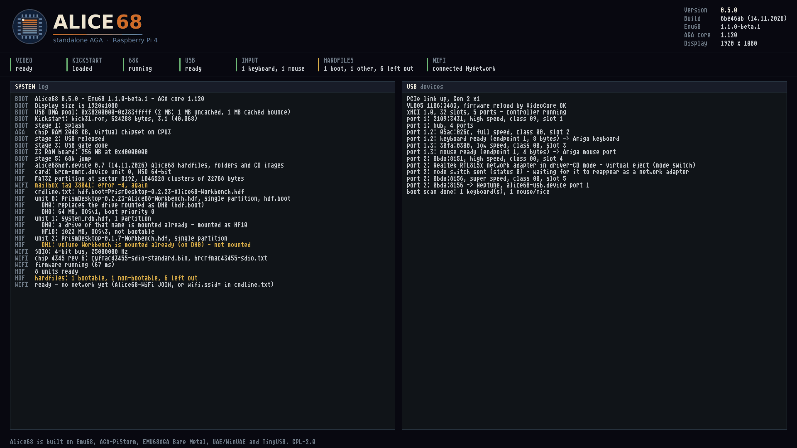
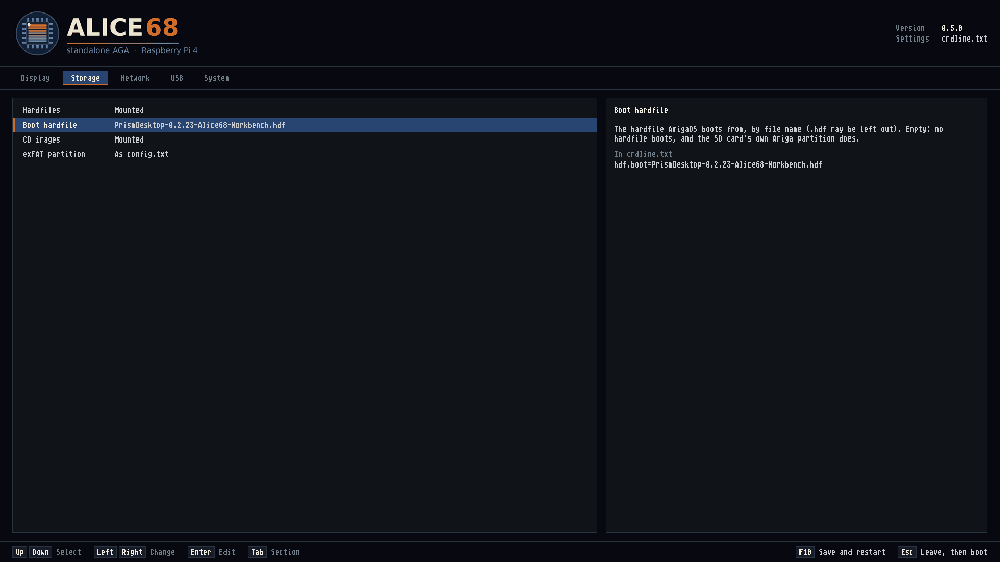
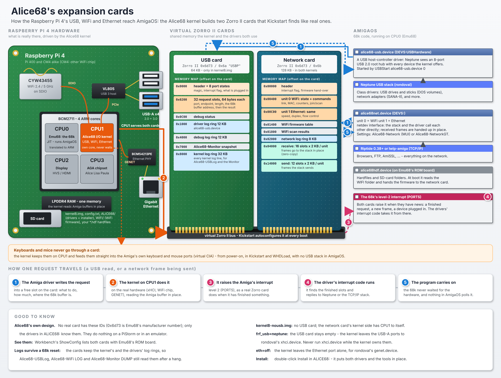

# Alice68

[](https://buymeacoffee.com/farsonic)

**A standalone AGA machine on a Raspberry Pi 4 (Pi 400 and CM4 untested): Workbench
and AGA software on a local HDMI display, with no PiStorm and no motherboard.**

Downloads: [Releases](https://github.com/farsonic/Alice68/releases) ·
What's new: [RELEASE-NOTES.md](RELEASE-NOTES.md) ·
Maintaining it with Claude: [docs/USING-CLAUDE.md](docs/USING-CLAUDE.md)

Alice68 is named after Alice, the AGA chip that succeeded Agnus, and the 68k that
Emu68 runs. It is a Pi 4 build of three projects, plus a Pi 4 USB stack of its own:

- **[Emu68](https://github.com/michalsc/Emu68)** by Michal Schulz: the 68k JIT
  (1.1.0-beta.1).
- **[AGA-PiStorm](https://astair86.itch.io/aga-pistorm-10-experimental-prototype)**
  1.120 by Astair86: the virtual Alice/Lisa/Paula, Copper and blitter, with output
  through the VideoCore VI and sound over HDMI.
- **[EMU68AGA Bare Metal](https://github.com/futureretrofusion/EMU68AGA-Bare-Metal)**
  by Future Retro Fusion: the standalone layer (virtual CIAs, ROM and ADF boot,
  Zorro III RAM, a TinyUSB host on the USB-C port).
- **Alice68's own additions:**
  - two **virtual Zorro II expansion cards** that AmigaOS finds like real ones (see
    [Alice68's expansion cards](#alice68s-expansion-cards)): a **USB card**, through which
    the kernel's own Pi 4 USB driver hands devices to the Neptune USB stack, and a
    **network card** for the Pi's built-in **WiFi** and **Gigabit Ethernet**;
  - USB keyboards and mice on the Pi's USB-A ports from power-on, and a "virtual eject"
    for USB network dongles that start in CD mode;
  - Amiga hardfiles (`.hdf`) straight from the SD card, bootable and writable, and SD-card
    folders as Amiga volumes;
  - a boot splash with live logs.

Credits and licences: [THIRD_PARTY_NOTICES.md](THIRD_PARTY_NOTICES.md),
[LICENSE](LICENSE). Every Emu68 file that differs from upstream, who changed it and why:
[docs/EMU68-CHANGES.md](docs/EMU68-CHANGES.md).

**Alice68 is an independent project.** It is not part of Emu68, and it is not endorsed
by Emu68's author. Joining Emu68 to a virtual AGA chipset on a bare Pi 4 is the work of
AGA-PiStorm, FRF and Alice68, and the Pi 4 USB and network drivers and the Amiga drivers
are Alice68's; Emu68's author has no part in any of it. The kernel calls itself Alice68, "based on Emu68"; it
keeps Emu68's `/emu68` device-tree entry only because Amiga drivers written for Emu68
look for it. **Report Alice68 problems here, not to Emu68 or the other upstream
projects.**

> **Status:** tested on a Raspberry Pi 4. It boots to Workbench at 1080p. A USB-A
> keyboard and mouse work from power-on. A Realtek RTL8156 network adapter on Neptune
> passed traffic at about 108 Mbit/s. Hardfiles on the SD card mount, boot and take
> writes; SD-card folders mount and take writes; the kernel's Ethernet (unit 1 of the
> network card) runs at about 92 Mbit/s on a 100 Mbit/s switch port; the splash's
> animation runs. Treat everything else (WiFi included) as experimental.

## Quick start

1. Take a microSD card with a **FAT32** first partition (any Raspberry Pi OS card, or
   one formatted on a PC).
2. Copy the **Raspberry Pi firmware** onto it: `start4.elf`, `fixup4.dat` and
   `bcm2711-rpi-4-b.dtb` (`-400` for a Pi 400) from
   [raspberrypi/firmware](https://github.com/raspberrypi/firmware/tree/master/boot).
3. Unzip the release and copy **everything in it** onto the card's root: `kernel8.img`,
   `kernel8-nousb.img`, `config.txt`, `cmdline.txt`, `floppy.txt`, the `overlays` folder
   and the `ALICE68` folder (Alice68's Amiga files, their installer, the read-mes and the
   licences, which AmigaOS sees as the volume `ALICE68:`; see
   [Folders](#folders-of-the-sd-card-as-amiga-volumes)). It replaces `config.txt`,
   `cmdline.txt` and `floppy.txt`: keep your own if you changed them.
4. Copy **your own** 512 KB A1200 Kickstart 3.x ROM onto it as **`kick31.rom`**, or
   change the name in `floppy.txt`. Kickstart is not included.
5. Plug a USB keyboard and mouse into the Pi's USB-A ports, connect HDMI0 (next to the
   USB-C power socket), and power on.

You get Kickstart's insert-disk screen. To get a Workbench, either put a hardfile on the
card (see [Hardfiles](#hardfiles-hdf-on-the-sd-card)), boot an ADF (see
[floppy.txt](#floppytxt-kickstart-and-adf)), or use Amiga partitions (MBR type `0x76`),
as with any Emu68 card.

The files in `boot/` work as they are. The next three sections explain what's in them
and what you can change.

## config.txt

The Raspberry Pi firmware reads `config.txt`. The default one, part by part:

```ini
[all]
kernel=kernel8.img        # Alice68
arm_64bit=1
disable_splash=1          # no rainbow screen
avoid_warnings=1
enable_uart=1
```
Leave these as they are.

**Display.** Alice68 uses **HDMI0**, the port next to the USB-C power socket.

```ini
hdmi_force_hotplug=1      # output even if the screen is detected late
hdmi_drive=2              # HDMI with sound (Paula is played over HDMI)
hdmi_group=1              # TV modes (CEA)
hdmi_mode=31              # 1080p50
disable_overscan=1        # the whole 1920x1080: without it the firmware leaves a 48-pixel border (1824x984)
```

The HDMI mode is set by the Pi's firmware at power-on and stays for the whole session:
AmigaOS screen modes (PAL, NTSC, hires, interlace, RTG) are scaled into it (`aga.scale=`),
so the monitor itself doesn't change mode. To change what the screen gets, change
`hdmi_mode` here (or on Alice68Prefs's Text files page) and restart.

| `hdmi_mode` | Picture |
|---|---|
| `31` | 1920×1080, 50 Hz (default: a PAL screen scales cleanly, Workbench text is sharp) |
| `16` | 1920×1080, 60 Hz |
| `19` | 1280×720, 50 Hz (if your screen prefers 720p) |
| `4` | 1280×720, 60 Hz |

Example: a 720p TV
```ini
hdmi_mode=19
```

**Kickstart.** It is named in its own file, so you can swap it without touching
`config.txt`:

```ini
include floppy.txt
```

**SD card for AmigaOS.** Emu68's `brcm-emmc.device` gives AmigaOS the card's Amiga
partitions (MBR type `0x76`, one drive each).

```ini
dtoverlay=emmc,unit0=rw
```

`unit0` is the **whole card**. Alice68's hardfile driver needs it, and it decides what
the hardfile driver may do:

| Setting | Effect |
|---|---|
| `dtoverlay=emmc,unit0=rw` | Hardfiles readable and writable (default) |
| `dtoverlay=emmc,unit0=ro` | Hardfiles read-only |
| `dtoverlay=emmc,unit0=off` | No hardfiles |
| `dtoverlay=emmc,unit0=rw,low_speed` | As the default, at 25 MHz: use this if your card gives errors (PFS3 reporting bad blocks, say) |

**Diagnostics (optional).** Emu68's on-screen HUD, off by default:

```ini
dtoverlay=diagnostic,hud
```

## floppy.txt: Kickstart and ADF

```ini
initramfs kick31.rom followkernel
```

The file name must match your ROM exactly, including case. Without a ROM the splash
stops with `FAIL: NO KICKSTART ROM LOADED`.

**Booting an ADF.** Join the ROM and a floppy image into one file on a PC, then name
that file here:

```bash
cat kick31.rom game.adf > kickadf.rom
```
(Windows: `copy /b kick31.rom+game.adf kickadf.rom`)

```ini
initramfs kickadf.rom followkernel
```

## cmdline.txt: Alice68's options

Everything goes on **one line**, separated by spaces. The default is:

```
aga.look=0 aga.scale=1
```

| Option | What it does |
|---|---|
| `aga.look=0` / `1` / `2` | Picture: sharp (default) / smooth / TV |
| `aga.scale=0` … `7` | Scaling: 0 4:3, 1 integer (default), 2 fill, 3 5:4, 4 16:9, 5 16:10, 6 21:9, 7 32:9 |
| `aga.nobootlog` | No log panels on the boot splash |
| `hdf.boot=NAME` | Boot from the hardfile `NAME` (see [Hardfiles](#hardfiles-hdf-on-the-sd-card)) |
| `hdf.readonly` | Hardfiles read-only |
| `hdf=off` | No hardfiles |
| `iso=off` | No CD images (see [CD images](#cd-images-iso-on-the-sd-card)) |
| `alice68.exfat=off` / `ro` / `rw` / `boot` | The exFAT partition as a volume (see [exFAT](#a-second-partition-in-exfat-big-cards-big-files)); here it wins over `config.txt`'s, and the setup screen writes it here |
| `frf_usb=neptune` | Leave the USB-A ports to AmigaOS (rondoval's `xhci.device` + Neptune) instead of the kernel; the USB-C port then takes keyboard, mouse and pads (untested on a Pi 4) |
| `frf_usb.nomodeswitch` | Don't switch Realtek USB network dongles out of driver-CD mode |
| `wifi.ssid="NAME"` `wifi.psk="PASSWORD"` | Join this WiFi network at boot (see [WiFi](#wifi-new-not-yet-tested-on-a-pi)) |
| `wifi.country=GB` | Your country: the WiFi channels allowed |
| `wifi=off` | Leave the WiFi chip off |
| `bt=off` | Leave Bluetooth off (see [Bluetooth](#bluetooth-keyboards-and-mice-new)) |
| `bt.dev=ADDRESS:KEY:KIND[:...]` | A paired Bluetooth device (Alice68Prefs writes these) |
| `eth=on` | Start the kernel's Ethernet at boot (it also starts when a stack opens `alice68net.device` unit 1) |
| `eth=off` | Keep the kernel off the Ethernet port (for rondoval's `genet.device`) |
| `net.oui=off` | Keep the Pi's own MAC addresses (otherwise both network units use Commodore's OUI, `00:80:10`) |
| `net.trace=1` | Log every ICMP (ping) frame and the first dropped frames to the network log (Alice68 MONITOR DUMP), kernel and alice68net.device |
| `status.sensors=mbox` | Also put the ARM clock, core voltage and throttling on the [status page](#status-page-for-monitors) (read through the VideoCore mailbox every 5 s; see there why it is off by default) |

Examples:

```
aga.look=0 aga.scale=1 hdf.boot=Workbench
```
boots from `Workbench.hdf`, with the default picture.

```
aga.look=2 aga.scale=0
```
gives a TV look, 4:3.

AGA-PiStorm's Chipset menu (`agaboot`) changes the picture at run time as well.

## The boot splash



The splash has five parts:

- **Header:** the Alice68 emblem, and the version, build, Emu68 and AGA core versions and
  the display size.
- **Status bar:** video, Kickstart, the 68k, USB, the input devices found, the hardfiles
  (how many boot, how many are mounted without booting, and how many were left out, with
  the reason in the SYSTEM panel) and the network (WiFi, and Ethernet when the kernel
  drives it). The edge of each cell shows its state: green ready, amber waiting, red failed.
- **SYSTEM panel:** the kernel log, with each line's source in a column of its own
  (`BOOT`, `HDF`, `WIFI`, `USB`, `AGA`, ...).
- **USB panel:** the USB log.
- **Footer:** credits, and for two seconds before AmigaOS starts, `DEL Setup`.

Failures show in red, so a photo of the screen is usually enough to diagnose a hang.
The splash keeps updating after the 68k starts - the hardfiles and the WiFi come in
then - and stops when AmigaOS puts its first picture up (or 30 s after the 68k started,
for a Workbench that opens straight on RTG), so nothing is drawn over AmigaOS's screen. `aga.nobootlog` in
`cmdline.txt` turns the log panels off. `tools/splash-preview/build.sh` renders the
splash and the setup screen on a PC with the kernel's own drawing code.

## Setup



While the footer shows `DEL Setup` (two seconds once the USB keyboard is found), press
**Del** or **F2** for Alice68's setup screen: the options of `cmdline.txt`, in five
sections.

| Section | Settings |
|---|---|
| Display | Picture (sharp, smooth, TV), scaling, boot log panels |
| Storage | Hardfiles (mounted, read-only, off), the hardfile to boot from, CD images, the exFAT partition (off, read-only, read-write, boot from it) |
| Network | WiFi on or off, network name, password and country; Ethernet (when a program opens it, at boot, off); MAC addresses (Commodore's or the Pi's own) |
| USB | The USB-A ports (Alice68 or AmigaOS), the Realtek dongle mode switch |
| System | Versions, display, keyboards and mice (read only) |

**Up/Down** pick a setting, **Left/Right** change it, **Enter** types into a text setting
(Enter again keeps it, Esc drops it), **Del** puts a setting back to its default, **Tab**
changes section. A changed value shows in orange. **F10** saves and restarts, **Esc**
leaves without saving; both ask first if anything changed.

Saving works through AmigaOS: the kernel can't write the SD card itself, so it hands
the changes to `alice68hdf.device`, which rewrites `cmdline.txt` while AmigaOS starts.
Then the Pi restarts with the new settings. Options the screen doesn't know (and the
firmware's own) stay as they are. The card must be writable (`dtoverlay=emmc,unit0=rw`);
otherwise the boot log says why nothing was written. The WiFi password is kept in
`cmdline.txt` as typed, as `wifi.psk=` always has been.

## Alice68Prefs and the Alice68 command

Alice68 has two programs on the Amiga side, named the way Riptide names its own:
**Alice68Prefs** (in `SYS:Prefs` after `ALICE68:Install`), the settings window, and
**`Alice68`** (in `C:`), one Shell command that does the same without a window.

**Alice68Prefs** needs MUI 3.8 or later (`muimaster.library` 19); without MUI it says so and
points to the `Alice68` command. One window on Workbench, in the look of RiptidePrefs: the
pages on the left under their headings, the page's name and what it is for above its
contents, **Save**, **Use**, **Restart Pi** and **Cancel** below, and a status line. Every
command is in the menus too (Project: Save, Use, Restart Pi, About, Quit; Edit: Last Saved;
Settings: Dark Theme, Help Bubbles). Keys: the underlined letters, **P** and **Shift-P** or the
cursor keys for the pages, **Esc** to cancel. Starting it again brings the window to the front.

| Heading | Pages |
|---|---|
| | **About** |
| System | **Status** (the kernel's [status page](#status-page-for-monitors), live), **Settings** (`cmdline.txt`'s options), **Text files** (`config.txt` and `cmdline.txt`) |
| Storage | **Card**, **Files** |
| Network | **Status**, **Ethernet**, **WiFi**, **Ethernet settings**, **WiFi settings**, **Ethernet traffic**, **WiFi traffic** (see [WiFi and Ethernet](#wifi-and-ethernet-alice68s-network-card-ethernet-tested-on-a-pi-wifi-still-being-tested)) |
| Input | **Bluetooth**, **Joystick** (the joystick port as games read it) |
| Diagnostics | **Logs** (the kernel's and the USB driver's, or the network board's: WiFi, Ethernet, Bluetooth; a filter, and Follow), **Monitor** (tasks, backtraces, the WiFi driver's state: what `Alice68 MONITOR DUMP` prints; Save to RAM:) |

```
Alice68Prefs [PUBSCREEN=name] [PAGE=name] [THEME=DARK|LIGHT] [DEBUG]
```

`PAGE=` takes a page's name or a heading (`PAGE=Bluetooth`, `PAGE=Network`); the icon's tool
types are the same arguments. `DEBUG` (Shell only) prints each step of the start, so if the
window stays empty or never opens, the last line shows where it stopped. Alice68Prefs runs on a
64 KB stack of its own, whatever stack the Shell or the icon gives it.

### Managing the SD card from AmigaOS

The Storage pages, **Settings**, **Text files** and **Bluetooth** look after the SD card
Alice68 started from. You don't need a PC for any of it.

| Page | What it does |
|---|---|
| Card | The card's partitions: type, file system, label, size, free space (**Count free space**). Which of them is Alice68's FAT partition, the exFAT volume, Emu68's own Amiga disk. Whether AmigaOS may write the exFAT partition. The hardfiles and CD images mounted from the card. |
| Files | Browse the FAT partition and the exFAT partition: folders first, sizes, `in use` for anything that can't be changed now. Filter to hardfiles, CD images, Kickstart ROMs or WiFi firmware. **Open**, **Parent**, **New folder**, **Rename to** (the name typed), **Delete...** (it asks first). **Boot from it** makes a hardfile the boot drive (`hdf.boot=`), **Use as Kickstart** makes a ROM the Kickstart (`initramfs` in `config.txt`). |
| Settings | The options of `cmdline.txt`, the same ones the [setup screen](#setup) offers (both use one table, `src/raspi/alice_opts.c`), and which Kickstart ROM `config.txt` names. Each option's help bubble says what it does. **Edit > Last Saved** drops your changes. |
| Bluetooth | The kernel's Bluetooth: its state, the paired devices (**Connect now**, **Forget...**), **Scan** and **Pair**, the passkey to type, and its last log lines. Pairings are written to `cmdline.txt` at once. See [Bluetooth](#bluetooth-keyboards-and-mice-new). |
| Text files | `config.txt` line by line: pick a line to change it, **Change**, **Add**, **Insert**, **Delete**. `cmdline.txt` as it will be saved; type into it (Return) to change it directly, and the Settings page follows. |

The WiFi password is never shown. The Settings page and the `cmdline.txt` line show
`********` in its place. Type a new one over it to change it, or empty the field to remove
it. Editing the line around `********` keeps the password as it is.

Nothing is written until you press **Save**, apart from what the Files page does at once
and a Bluetooth pairing.
Save writes `cmdline.txt` and `config.txt`, and keeps the previous versions as
`cmdline.txt.bak` and `config.txt.bak`. **Restart Pi** starts the Pi again so the new
settings take effect. It asks first if there are changes you haven't saved.

All of it goes through `alice68hdf.device`'s card service, with the same FAT and exFAT
code its folder volumes use, one request at a time. So the card stays consistent while
volumes are mounted. Mounted hardfiles and CD images, files open on a folder volume, and
folder volumes' own folders can't be deleted, renamed or overwritten. The exFAT partition
is only written with `alice68.exfat=rw` (or `boot`), and nothing at all on a read-only
card (`dtoverlay=emmc,unit0=ro`).

### The Alice68 command

`C:Alice68` alone, or `Alice68 HELP`, lists what it does. Each subcommand was a program of its
own up to Alice68 0.6 (the old name in brackets); the arguments are the same.

| Command | What it does |
|---|---|
| `Alice68 STATUS [LOOP]` | The kernel's status page: cores, temperature, JIT, USB, network (was `Alice68-Status`) |
| `Alice68 CARD [INFO [FREE]]` | The SD card's partitions, free space, what is mounted (was part of `Alice68-Card`) |
| `Alice68 CARD LIST [path] [EXFAT]`, `DELETE`, `RENAME`, `MKDIR` | Files of the FAT (or exFAT) partition |
| `Alice68 CARD OPTIONS`, `SET option ...` | `cmdline.txt`'s options as the Settings page has them; `SET aga.scale=4 wifi.country=GB` or `SET Scaling=16:9` changes and saves them |
| `Alice68 CARD BOOT name.hdf`, `KICKSTART [name.rom]` | The hardfile to boot from; the Kickstart ROM (without a name: the ROMs on the card) |
| `Alice68 CARD CONFIG [SET n text \| ADD text \| INSERT n text \| DELETE n]`, `CMDLINE ["line"]` | `config.txt` line by line; `cmdline.txt` as one line (`wifi.psk=********` keeps the password) |
| `Alice68 CARD RESTART` | Restarts the Pi through the network board |
| `Alice68 BT [LIST]`, `SCAN`, `PAIR addr`, `CONNECT addr`, `FORGET addr`, `KEEP` | Bluetooth; KEEP writes the paired list into `cmdline.txt` (Alice68Prefs does that by itself) |
| `Alice68 WIFI [START\|SCAN\|JOIN "name" "pass" [CC]\|RECONNECT\|DISCONNECT\|LOG\|OFF]` | The kernel's WiFi (was `Alice68-WiFi`) |
| `Alice68 LOG [ALL] [LINES=n] [MATCH=text] [FOLLOW]` | The kernel's and the drivers' logs (was `Alice68-USBLog`) |
| `Alice68 JOYTEST [ONCE] [MOUSEPORT]` | The joystick port as games read it (was `Alice68-JoyTest`) |
| `Alice68 HDF` | The hardfiles, folders and CD images found, and why (was `Alice68-HDF`) |
| `Alice68 NETCHECK [device] [unit] [WATCH\|TEST]` | What a network driver reports (was `Alice68-NetCheck`) |
| `Alice68 SHOWCONFIG [ALL ...]` | Boards, memory and Alice68's cards (was `Alice68-ShowConfig`) |
| `Alice68 MONITOR [DUMP]` | The debugging window; DUMP prints it all (was `Alice68-Monitor`) |
| `Alice68 WHEEL [NEWMOUSE]` | The mouse wheel helper; run again to stop it (was `Alice68-Wheel`) |

SET, BOOT, KICKSTART, CONFIG's changes and CMDLINE write the file at once, the old one kept as
`.bak`. `Alice68-Card`, `Alice68-Network` and `Alice68-NetworkGT` are Alice68Prefs's pages now.

## Alice68's expansion cards

A real Amiga gets USB or networking from a card in a Zorro slot. Alice68 has no slots,
so its kernel **makes the cards up**: when the Amiga starts, Kickstart's expansion
setup (autoconfig) finds them on a virtual Zorro II bus and gives each an address, as
it would a real card. AmigaOS's drivers then talk to them the way drivers talk to any
Zorro card, through the card's memory and its interrupt.

What is on the card, though, is done by the **Raspberry Pi's own hardware**, driven by
the Alice68 kernel on CPU1 (the second ARM core), not by the 68k. The card is the
meeting point: the Amiga driver writes a request into the card's memory, the kernel
carries it out on the Pi's USB, WiFi or Ethernet hardware, writes the answer back and
raises the Amiga's level-2 (PORTS) interrupt, as a real card would. The 68k never
waits for the hardware.

[](docs/images/alice68-cards.png)

<details>
<summary>The same as text</summary>

```
       Raspberry Pi 4 hardware            Alice68 kernel             virtual Zorro II cards              AmigaOS (68k on CPU0)
     ---------------------------     ----------------------     ------------------------------     ------------------------------

     USB-A ports  (VL805 xHCI) --+                                +----------------------------+
                                 |                          +---> | USB card           64 KB   | <--> alice68-usb.device
                                 +--> xHCI driver  (CPU1) --+     | Zorro II 0x6d73/0x6a "USBP"|      (DEVS:USBHardware)
                                 |       |                  |     | requests, buffers, logs    |          ^
     keyboards and mice <--------+       |                  |     +----------------------------+          |
     go straight to the Amiga's          |                  |                                         Neptune USB stack:
     keyboard and mouse  <---------------+                  |                                         storage, network
     (virtual CIA, from power-on)                           |                                         adapters, ...
                                                            |
     WiFi (CYW43455, SDIO) ------+                          |     +----------------------------+
                                 +--> network   (CPU1) -----+---> | Network card      128 KB   | <--> alice68net.device
     Gigabit Ethernet (GENET) ---+    WiFi + Ethernet       |     | Zorro II 0x6d73/0x6b       |      unit 0 WiFi
                                                            |     | frames, state, settings,   |      unit 1 Ethernet
                                                            |     | scan results, logs         |          ^
                                                            |     +----------------------------+          |
                                                            |                                         Riptide or lwip-amiga
                                                            |                                         (netdev)
                                                            +---- level-2 (PORTS) interrupt ----> 68k: "a card has news"
```

</details>

| Card | Zorro II ID (manufacturer/product) | Size | AmigaOS driver | Done by the kernel | In |
|---|---|---|---|---|---|
| **USB card** | `0x6d73` / `0x6a` (106), serial "USBP" | 64 KB | `DEVS:USBHardware/alice68-usb.device`, for Neptune | the Pi 4's USB-A ports (xHCI on PCIe) | `kernel8.img` |
| **Network card** | `0x6d73` / `0x6b` (107) | 128 KB | `DEVS:alice68net.device`, units 0 and 1, for a netdev TCP/IP stack | WiFi (SDIO) and Gigabit Ethernet (GENET) | both kernels |
| Emu68's ROM board | `0x6d73` / `2` | - | holds `alice68hdf.device` (hardfiles, folders) and Emu68's own drivers | - | both kernels |

`0x6d73` is Emu68's manufacturer number. Workbench's `ShowConfig` lists the cards;
**`Alice68 SHOWCONFIG`** (in `C:` after `ALICE68:Install`) says much more: the processor,
Kickstart, chipset and every memory region; each board's Zorro type, address, size,
serial, flags and driver, with names for Emu68's and Alice68's boards; and what is live on
Alice68's cards - the USB devices passed through and the request slots, both network
units' link, addresses, WiFi network, counters and queues, and `alice68hdf.device`'s
hardfiles and folders. `Alice68 SHOWCONFIG ALL` adds the libraries, devices and resources
in memory and the end of the kernel's log; `SYS`, `MEM`, `BOARDS`, `CARDS`, `LIBS` and
`LOG` pick parts.
They are **Alice68's own design**: no real card has these IDs, and the drivers in
`ALICE68:` are the only ones that know them. They do nothing on a PiStorm or an
emulator.

What this gives:

- **No driver in AmigaOS touches the Pi's hardware**, so there's nothing for a 68k
  driver to get wrong or slow down: the kernel's drivers run on their own ARM core,
  beside the 68k, and keep running while AmigaOS reboots. Keyboards and mice are the
  kernel's from power-on, inside WHDLoad too, without any USB stack in AmigaOS.
- **The Amiga side is small and ordinary**: a USB host-controller driver Neptune
  already knows how to use (the classic `IOUsbHWReq` interface), and a network driver
  for the netdev interface. They are installed from `ALICE68:` like any other driver.
- **The logs survive a 68k reset**: both cards keep the kernel's and the drivers' log
  rings, which `Alice68 LOG`, `Alice68 WIFI LOG` and `Alice68 MONITOR` read even
  after a hang and a Ctrl-Amiga-Amiga.

The **no-USB kernel** (`kernel8-nousb.img`) has no USB card: the network card's
kernel side then has CPU1 to itself. With `frf_usb=neptune` in `cmdline.txt` the USB
card is still there but stays empty: the kernel leaves the USB-A ports to rondoval's
`xhci.device`.

### Status page for monitors

The kernel keeps a small **status page** that any 68k program can read: what each ARM core
does (and how busy it is, where that is measured), the SoC's temperature, Emu68's translation
cache, the network units' counters and the kernel's build. **`Alice68 STATUS`** (in `C:` after
`ALICE68:Install`) prints it; `Alice68 STATUS LOOP` every second until Ctrl-C.

For monitor programs:

- **Where:** `devicetree.resource`, node `/alice68`, property `status` (one 32-bit word: the
  page's address) and `status-version` (1). The page is a read-only 4 KB page in Emu68's ROM
  board, there from the start of AmigaOS. Nothing calls into the kernel; writes to it fault.
- **Layout:** `third_party/Emu68/src/alice/alice_status.h` (`struct alice68_status`, 416
  bytes, offsets checked at compile time). Every field is a big-endian 32-bit word or a
  NUL-terminated string. Counters wrap at 32 bits.

  | Offset | Field |
  |---|---|
  | `0x000` | `magic` `'A68S'`, `version` 1, `size`, `seq`, `uptime_ms`, `interval_ms`, `flags` |
  | `0x020` | `build`: the kernel's version, build date and `git:` commit (96 bytes) |
  | `0x080` | `core[4]`: `role` (1 68k JIT, 2 USB and network, 3 display, 4 chipset), `busy` (hundredths of a percent), `name` (24 bytes) |
  | `0x100` | `temp_mc` (thousandths of a degree C), `arm_hz`, `core_uv`, `throttled`, `sensors_ms` |
  | `0x120` | `jit_total`, `jit_free` (bytes), `jit_units` (blocks now), `jit_translations` (since boot), `jit_flushes`, `jit_hits` |
  | `0x140` | `net[2]` (unit 0 WiFi, unit 1 Ethernet): `kind`, `link`, `rx_pkts`, `tx_pkts`, `rx_bytes`, `tx_bytes`, `rx_drop`, `tx_err` |
  | `0x180` | `usb_in_bytes`, `usb_out_bytes`, `sd_read_blocks`, `sd_write_blocks` |

- **Reading it:** read `seq`, the fields, then `seq` again. If `seq` is odd (the kernel is
  writing) or changed, read again. It moves by 2 about once a second; if it stops moving,
  the kernel's CPU1 loop isn't running it (with `frf_usb=neptune` CPU1 runs other code).
- **`0xFFFFFFFF` means "not measured here"**, never a guess. Today that is: the busy figure
  of cores 0, 2 and 3 (the 68k's core has no idle moment the kernel could see; the display
  and chipset loops have no cheap point to time); JIT flushes and hits (Emu68 doesn't count
  them); USB bytes; SD blocks (the card is driven from AmigaOS by `brcm-emmc.device`).
  Core 1's figure is the time its loop spends beyond its shortest, empty turn.
- **Temperature** comes from the SoC's own sensor register, without the mailbox.
  **Clock, voltage and throttling** need the VideoCore mailbox, whose answers come back on
  one channel for everyone: a call by the kernel can take the answer a 68k program (the RTG
  driver, a monitor) is waiting for, and the other way round. So they are read only with
  `status.sensors=mbox` in `cmdline.txt` (every 5 s; `flags` bit 0 says so, `sensors_ms`
  when). **Monitors should read temperature and the rest here rather than calling the
  mailbox themselves.** `throttled` holds the firmware's bits: 0 under-voltage, 1 clock
  capped, 2 throttled, 3 soft temperature limit, and 16-19 the same "since boot".

## USB

| Port | Default | With `frf_usb=neptune` |
|---|---|---|
| **USB-A ×4** (and the Pi 400 keyboard) | **The Alice68 kernel:** keyboards and mice go straight to the Amiga's keyboard and mouse port, from power-on and inside WHDLoad. Every other device (storage, network) is passed to **Neptune** in AmigaOS. | AmigaOS: rondoval's `xhci.device` + Neptune |
| **USB-C** (power socket) | not used | FRF's TinyUSB host in the kernel: keyboards, mice, pads, `usbmass.device` (tested by FRF on a Pi 3, untested on a Pi 4) |

A CM4's USB port is the USB-C controller, so on a CM4 use `frf_usb=neptune` (untested).

### Resetting

- **Ctrl-Amiga-Amiga** resets the Amiga side, as on a real Amiga. The Amiga keys are a USB
  keyboard's **Windows keys** (or a Mac keyboard's **Cmd keys**): press **Ctrl + left
  Windows/Cmd + right Windows/Cmd**. The Pi keeps running, so Alice68's logs survive (see
  `Alice68 MONITOR DUMP`). If AmigaOS has hung and can't take the request within 2 seconds,
  the whole Pi restarts instead. Keyboards without a right Windows key (often a Menu key
  there) can't make the chord; use the full restart below. With `frf_usb=neptune` (USB-C)
  it always restarts the whole Pi.
- **Ctrl + Left Shift + F11** restarts the whole Pi, like switching it off and on.

### The mouse's scroll wheel

The Amiga's mouse port has no wheel, so the kernel counts a USB mouse's wheel steps on the
[USB card](#alice68s-expansion-cards), and **`Alice68 WHEEL`** turns them into the
"NewMouse" events most wheel-aware programs know (raw keys `$7A`/`$7B` for up and down,
`$7C`/`$7D` for left and right, `$7E` for the 4th button), with Shift and the other
qualifiers as you hold them. **Install** puts it in `C:` and in `WBStartup`, so it starts
with Workbench. Running it again (or double-clicking its icon) stops it, and
`Alice68 WHEEL NEWMOUSE` also sends each event as `IECLASS_NEWMOUSE` for tools that want
that. Without installing: `Run >NIL: ALICE68:C/Alice68 WHEEL`.

The kernel reads the wheel from the mouse's own report layout (its HID report descriptor).
A mouse without a wheel, or one whose layout the kernel cannot read, works as before
(buttons and movement), and the boot log says `wheel for Alice68 WHEEL` after a mouse that
has one. Mice on the USB-C port (`frf_usb=neptune`) have no wheel through the kernel.

### Neptune on the USB-A ports (storage, network)

The kernel keeps USB keyboards and mice for itself and offers every other device on the
[USB card](#alice68s-expansion-cards). To use them in AmigaOS:

1. Install [Neptune](https://github.com/rondoval/neptune-usb-stack) 6.3 or later. It
   needs no host-controller driver of its own here: **don't** use `xhci.device` while the
   kernel owns the USB-A ports, as the two cannot share the controller.
2. Install `alice68-usb.device` into `DEVS:USBHardware/`: double-click **Install** in
   `ALICE68:` (it also puts the `Alice68` command in `C:`), or copy them by hand.
3. Start Neptune on it, from a Shell or at every boot in `S:User-Startup`:
   ```
   C:USBStart >NIL: alice68-usb.device 0
   ```
   or choose `alice68-usb.device`, unit 0, in **Neptune USB**. If Neptune's installer
   added a `USBStart` line for `xhci.device`, change it to this.

Neptune sees an 8-port USB 2.0 root hub, with every device the kernel doesn't keep for
itself on it. USB 3 devices work as USB 2.0. `Alice68 LOG FOLLOW` tails the kernel's and
the driver's USB logs in a Shell.

`Alice68 LOG` prints the last 40 lines of each log. `LINES=200` prints more, `ALL`
everything, and `MATCH=[BT]` only the lines with that text. Ctrl-C stops it at any line.
For example, the Bluetooth lines only:

```
Alice68 LOG MATCH=[BT] LINES=100
```

- **Network adapters:** the Neptune class is the SANA-II driver. For `cdceth.usbclass`,
  give your TCP/IP stack `usbcdceth.device`, unit 0, as a bare name.
- **Virtual eject:** Realtek RTL815x adapters that start as a driver CD (`0bda:8151`)
  are switched to network mode by the kernel. `frf_usb.nomodeswitch` turns this off.
- **Leaving the USB-A ports to AmigaOS:** `frf_usb=neptune` in `cmdline.txt` keeps the
  kernel off them, so rondoval's `xhci.device` can drive them instead.

## WiFi and Ethernet: Alice68's network card (Ethernet tested on a Pi, WiFi still being tested)

The **kernel** runs the Pi 4's built-in WiFi (the Cypress CYW43455 chip) and its Gigabit
Ethernet port (GENET) on CPU1, beside USB, and AmigaOS sees one network card with two
units: `alice68net.device` **unit 0 is the WiFi, unit 1 the Ethernet**. The driver speaks
lwip-amiga's `netdev` interface, which is faster than SANA-II (the stack and the driver call
each other directly): rondoval's **lwip-amiga** (the
[driver stack](https://github.com/rondoval/emu68-driver-stack/releases)'s archives) and
**Riptide** (**0.38 or later**: earlier versions hang after the first ping with a driver
that reports sent frames as promptly as this one) can use it; Roadshow, AmiTCP and Miami (SANA-II
only) cannot. The WiFi chip's own firmware does the WPA2 handshake (and WPA3 where the
firmware supports it).

Alice68Prefs's **Network** pages are the settings window (they were `Alice68-Network`):

- **Status** (both units and all traffic of the last minute);
- **Ethernet** (the link: rate, duplex, autonegotiation, what each side
  offers, flow control, link downs, time up, the MAC address) and **WiFi** (the connection,
  and the networks in range: Scan, then a click on one to join it);
- **Ethernet settings** (an on/off switch; autonegotiation and the speeds and duplexes
  to offer, or a fixed speed and duplex; flow control) and **WiFi settings** (an on/off switch;
  network name, password - dots unless Show is ticked -, country, Join and save,
  Disconnect, power saving);
- **Ethernet traffic** and **WiFi traffic** (rates, bytes, packets, drops and errors in and out,
  and a graph of the last minute).

**The on/off switches** at the top of the two Settings pages switch a unit's hardware off
and on, also while a TCP/IP stack is using it: switched off, the stack sees the link go
down, nothing is sent or received, and it stays off - a stack starting, the WiFi's
automatic restart or new firmware do not switch it on again - until the switch is turned
on. On again, the WiFi rejoins its network and the Ethernet starts if a stack uses it.
The line beside each switch says what it means right now. **Save** keeps the switches'
positions for the next start (`UNIT0=OFF` / `UNIT1=OFF` in `alice68net.prefs`).

**Use** gives the kernel the settings now; **Save** also keeps them for the next start
(the WiFi network in `ENVARC:alice68wifi.prefs`, the Ethernet and WiFi settings in
`ENVARC:alice68net.prefs`, which `alice68net.device` applies when it starts). Without MUI,
`Alice68 WIFI JOIN` and `RECONNECT` do the WiFi from a Shell.

**Commodore's MAC prefix.** Both units' MAC addresses start with Commodore International's
`00:80:10`; the last three bytes are the Pi's own. `net.oui=off` in `cmdline.txt` keeps the
Pi's addresses. (Your router sees a new machine the first time: a DHCP server may give it a
new address.)

### WiFi

1. **Firmware**, on the SD card's FAT partition (where `kick31.rom` is), in a folder
   named **`WIFI`**. Alice68 can't include it (it isn't ours to distribute). The `.bin`
   is the chip's firmware, the `.txt` the board's radio settings (both needed), the
   `.clm_blob` the regulatory data (which channels each country may use):

   | Board | Files |
   |---|---|
   | Pi 4 Model B, Pi 400 | `cyfmac43455-sdio-standard.bin`, `cyfmac43455-sdio.clm_blob`, `brcmfmac43455-sdio.txt` |
   | Compute Module 4 | `brcmfmac43456-sdio.bin`, `brcmfmac43456-sdio.clm_blob`, `brcmfmac43456-sdio.txt` |

   They are in Raspberry Pi's
   [firmware-nonfree](https://github.com/RPi-Distro/firmware-nonfree/tree/bullseye/debian/config/brcm80211)
   repository, branch `bullseye` (see below why not `bookworm`), under
   `debian/config/brcm80211/` (`cypress/` and `brcm/`). A current Raspberry Pi OS card has
   the newer firmware that does not work with Alice68's WPA; a Raspberry Pi OS "bullseye"
   card has the right one in `/lib/firmware/cypress/`.

   **All of it in one go**, straight onto the card from a Mac or Linux (WiFi and the
   Bluetooth firmware; change `/Volumes/EMU68` to where your card's FAT partition is):
   ```bash
   mkdir -p /Volumes/EMU68/WIFI && cd /Volumes/EMU68/WIFI && \
   curl -fL --remote-name-all \
     https://raw.githubusercontent.com/RPi-Distro/firmware-nonfree/bullseye/debian/config/brcm80211/cypress/cyfmac43455-sdio-standard.bin \
     https://raw.githubusercontent.com/RPi-Distro/firmware-nonfree/bullseye/debian/config/brcm80211/cypress/cyfmac43455-sdio.clm_blob \
     https://raw.githubusercontent.com/RPi-Distro/firmware-nonfree/bullseye/debian/config/brcm80211/brcm/brcmfmac43455-sdio.txt \
     https://raw.githubusercontent.com/RPi-Distro/bluez-firmware/master/broadcom/BCM4345C0.hcd && \
   ls -l
   ```
   That is for a Pi 4 Model B. You should see four files: 637,406, 2,676, 2,074 and 63,806
   bytes. On Windows, make the `WIFI` folder on the card, open PowerShell in it and run the
   `curl` part as one line, with `curl.exe` for `curl` and without the `\` line ends.

   **The firmware must be version 7.45.241 (from Raspberry Pi's `bullseye` branch, as above),
   not the newer 7.45.265 on `bookworm`** (609,309 bytes). Raspberry Pi built 7.45.265 without
   the chip's own WPA handshake (Raspberry Pi OS does it in Linux), and Alice68 relies on the
   chip's: with it, WiFi stops at "this firmware has no WPA supplicant". Open networks work
   with either.

   For a Compute Module 4, take the 43456 files instead of the first three (the same
   repository, all under `brcm/`). **Its firmware (7.84.17.1, on every branch) has no WPA
   handshake of its own either, so a CM4 joins only open networks until Alice68 does the
   handshake itself:**
   ```bash
   curl -fL --remote-name-all \
     https://raw.githubusercontent.com/RPi-Distro/firmware-nonfree/bookworm/debian/config/brcm80211/brcm/brcmfmac43456-sdio.bin \
     https://raw.githubusercontent.com/RPi-Distro/firmware-nonfree/bookworm/debian/config/brcm80211/brcm/brcmfmac43456-sdio.clm_blob \
     https://raw.githubusercontent.com/RPi-Distro/firmware-nonfree/bookworm/debian/config/brcm80211/brcm/brcmfmac43456-sdio.txt
   ```
   Put only the Bluetooth file your board's chip wants in `WIFI`: `BCM4345C0.hcd` on a
   Pi 4 Model B; `BCM4345C5.hcd` (same place, `.../broadcom/BCM4345C5.hcd`) on a Pi 400.
   The wrong one loads but leaves Bluetooth dead (the kernel's log names the chip it
   found: `chip ROM name: ...`). macOS adds `._` files next to them; they are ignored.

   At boot `alice68hdf.device` reads them and hands them to the kernel, which starts the
   chip straight away: the splash's status strip shows **WIFI** and what it is doing.
2. **The network**, either in `cmdline.txt` (it then joins at boot, before AmigaOS):
   ```
   aga.look=0 aga.scale=1 wifi.ssid="MyNetwork" wifi.psk="my password" wifi.country=GB
   ```
   or from AmigaOS (`Alice68 WIFI` is installed into `C:` by `ALICE68:Install`):
   ```
   Alice68 WIFI JOIN "MyNetwork" "my password" GB
   ```
   which also saves `ENV:` and `ENVARC:alice68wifi.prefs`; then `Alice68 WIFI RECONNECT`
   in `S:User-Startup` joins it at every boot. `wifi.country` (or the third word of JOIN)
   is your two-letter country code: the channels allowed. `wifi=off` in `cmdline.txt` keeps
   the chip off; `wifi.sdclock=` sets the SDIO clock (25000000 by default).
3. **The TCP/IP stack:** `ALICE68:Install` puts `alice68net.device` in `DEVS:`. For Riptide
   (installed from `ALICE68:Riptide`), give RiptidePrefs the device `alice68net.device`,
   unit 0 (see its ReadMe). For lwip-amiga, make a file
   `DEVS:NetInterfaces/wifi` with
   ```
   DEVICE=alice68net.device
   UNIT=0
   TYPE=NETDEV
   ADDRESS=DHCP
   ```
   (`AddNetInterface` in `S:Network-Startup` adds the files in that folder). lwip-amiga
   carries one interface at a time: WiFi or the Ethernet port, so give the other file
   `STATE=DOWN`.

### Ethernet (unit 1)

The kernel's Ethernet starts when a TCP/IP stack opens `alice68net.device` unit 1 (or at
boot with `eth=on` in `cmdline.txt`, so the splash's **LAN** field shows the link):
```
DEVICE=alice68net.device
UNIT=1
TYPE=NETDEV
ADDRESS=DHCP
```
in `DEVS:NetInterfaces/eth` for lwip-amiga. It then marks the port disabled in the device
tree for AmigaOS: **use either the kernel's Ethernet or rondoval's `genet.device`, not
both**. `eth=off` in `cmdline.txt` keeps the kernel off the port entirely, for
`genet.device`: `alice68net.device` then refuses unit 1 at once, and the log says why
(`[alice68net] unit 1: Ethernet is off in the kernel (eth=off in cmdline.txt): open
refused`). Remove `eth=off` to use unit 1 again. It runs at 10, 100 or 1000 Mbit/s, as
the link negotiates.

**rondoval's `genet.device` instead** (for Roadshow, AmiTCP or Miami, which speak only
SANA-II): put `eth=off` in `cmdline.txt`. Alice68's Emu68 has the dcache extensions (the
`dcache-range-ops` property), so take the **`-rangeops`** archive of rondoval's
[driver stack](https://github.com/rondoval/emu68-driver-stack/releases)
(`emu68-drivers-<ver>-rangeops.lha`) and use its SANA-II `genet.device` **3.x**, in
`DEVS:Networks/`: give the stack the full path `DEVS:Networks/genet.device`, unit 0. (Its
4.x `genet.device` is a netdev driver like `alice68net.device` unit 1, which does the same
job.) `Alice68 NETCHECK` prints what a SANA-II driver reports, as text, on any AmigaOS:
link rate, MAC address, packets and whether its interrupts reach AmigaOS.
`Alice68 NETCHECK WATCH` repeats the counters every second; `Alice68 NETCHECK TEST` brings
the interface up if no TCP/IP stack has, sends three broadcast test frames and says
whether the link, the hardware and its interrupts work. It never loads a second copy of a
driver a stack is using.

**Remove any other WiFi driver from AmigaOS's start-up** (WiFiPi.device and the like, in
`DEVS:NetInterfaces/`, `S:User-Startup` or a stack's own settings): the kernel drives the
chip now, and another driver resetting the same controller cuts it off. The kernel marks the
controller disabled in the device tree for AmigaOS; if something resets it anyway, the
splash and `Alice68 WIFI LOG` say "the WiFi controller was reset by someone else", and the
kernel starts the chip again 5 seconds later.

`Alice68 WIFI` on its own shows the state, the network, the signal and the counters;
`SCAN` lists the networks in range; `LOG` shows the kernel's WiFi log (the same lines are
on the splash and the serial log as `[WIFI] ...`) - send that if WiFi does not come up.
`DISCONNECT`, `OFF` (chip off) and `START` (on again) do what they say.

**When something hangs: `Alice68 MONITOR`.** Start it first (`run Alice68 MONITOR`): a
window at priority 21 that keeps updating while the mouse still moves. It shows what the
WiFi is doing now, every task with its state, the signals it waits for and a backtrace,
and the logs of the kernel, the network and the USB driver as they grow. Keys: space
pauses, `1`-`5` choose the log, `t` the size of the task list, `q` quits. The logs live on
the kernel's boards, which a 68k reset (Ctrl-Amiga-Amiga) does not clear: after a hang,
reset and run `Alice68 MONITOR DUMP >RAM:dump.txt` to get what led up to it, including the
monitor's last task table.

Not supported: WEP, WPA-Enterprise, hidden networks only by name (they are tried when
not seen in a scan), access-point mode.

## Bluetooth keyboards and mice (new)

The Pi 4's WiFi chip also does Bluetooth, and the kernel now drives it: Bluetooth
keyboards and mice work on the Amiga like USB ones, Classic ones and Bluetooth Low
Energy (LE) ones (many newer mice and slim keyboards). Keyboards include
Ctrl-Amiga-Amiga; mice include the wheel, for `Alice68 WHEEL`. LE support is new and has
only been tested on a PC against a scripted device so far.

1. **The firmware.** Copy `BCM4345C0.hcd` into the `WIFI` folder on the SD card (the
   one-line download under [WiFi](#wifi) fetches it with the WiFi files). It's in
   the Raspberry Pi OS package `bluez-firmware`, as
   `/lib/firmware/brcm/BCM4345C0.hcd` on a Pi; a Pi 400 uses `BCM4345C5.hcd`. Like the
   WiFi firmware, it isn't ours to ship. `alice68hdf.device` hands it to the kernel
   while AmigaOS starts, so Bluetooth comes up a few seconds into the boot, not on the
   splash. Without the file, the chip's own older firmware is tried.
2. **Pairing.** Open Alice68Prefs, **Bluetooth** page (or use `Alice68 BT` in a Shell). Put the keyboard or mouse in
   pairing mode, press **Scan**, pick it in the lower list, press **Pair**.
   - A keyboard: type the six digits shown on the Bluetooth keyboard, then Enter.
   - A mouse: it pairs by itself.
   - Old devices that ask for a PIN get `0000`.
   - LE devices are marked "(LE)" in the list and pair the same way. A device that
     insists on LE Secure Connections pairing can't pair yet: the page says so.
3. **After that,** paired devices are kept in `cmdline.txt` (`bt.dev=ADDRESS:KEY:KIND`,
   KIND a hex digit: 1 keyboard + 2 mouse + 4 LE + 8 game pad,
   with `:EDIV:RAND:TYPE[:IRK]` after it for an LE device; Alice68Prefs writes it at once). They reconnect by themselves at every boot once
   AmigaOS is starting, usually when you press a key or move the mouse. **Connect now**
   calls one, **Forget...** removes it.

The splash's status bar shows a BLUETOOTH cell, and the SYSTEM log has `BT` lines.
`bt=off` in `cmdline.txt` (or Settings → Bluetooth) leaves the chip off.

### Bluetooth game pads as Amiga joysticks (new, not yet tried on a Pi)

A Bluetooth game pad or joystick plays in the Amiga's **joystick port**, as a joystick
does: games and Workbench programs see directions and fire buttons, nothing to install.
Classic pads (most cheap pads, DualShock 4, Switch Pro, 8BitDo) and LE ones (Xbox
Wireless Controller, newer pads) both work. Pair it like a mouse: pairing mode on the
pad, **Scan**, pick it ("game pad" in the list), **Pair**; no code to type.

- **What goes where:** the D-pad and the left stick (past 40 % of its way) are the four
  directions, together. The bottom face button fires (fire 1), the right one is fire 2
  (pin 9), the left one fire 3 (pin 5): A/B/X on an Xbox pad, Cross/Circle/Square on a
  PlayStation pad, B/A/Y on a Switch pad, buttons 1/2/3 on others.
- **Two pads:** the first plays in the joystick port, a second in the **mouse port** (the
  mouse moves the same port's counters, so leave it still; fire 2 and 3 work in the
  joystick port only).
- **Other buttons:** `bt.pad.buttons=F,F2,F3` in `cmdline.txt` names the pad's buttons
  (their HID numbers, 1-16) for fire, fire 2 and fire 3, and `bt.pad.jump=N` makes a button
  push Up as well (for games that jump with Up). Turn a pad's buttons into numbers by
  pressing them with `Alice68 LOG MATCH=[BT]` open: the first reports are logged.
- **Which mode:** pads with several modes (picked with a button held at power-on) should
  be paired in their **Android / D-input** mode first; a Switch mode (it pretends to be a
  Switch Pro controller, report `0x3F`) works too. The **Fantech EOS Mini**: Android/D-input.
  The log says once, at each connection, what it found: `game pad: report N, X/Y n bits,
  hat yes/no, n buttons` - a photo of that line tells which mode a pad is in.
- **Testing it:** `Alice68 JOYTEST` (in `C:` after `ALICE68:Install`) prints, live, what a
  game reads from the joystick port: the directions, fire, fire 2 and fire 3, a line per
  change, Ctrl-C to stop (`ONCE`: just now; `MOUSEPORT`: the mouse port too, for a second
  pad - a mouse moving there shows as random directions, as a game would read it). It reads the same chip registers games do, so what
  moves there moves in games. For a game: WHDLoad games run from Workbench (on a hardfile
  or a folder), or boot an ADF with `floppy.txt` (see [floppy.txt](#floppytxt-kickstart-and-adf)).
- **How:** a pad has no boot protocol, so the kernel reads its HID report descriptor
  (Classic: from its SDP record; LE: its Report Map) and decodes its reports from that
  (`frf_usb/xhci/alice_pad.c`, tested in `tools/hid-test` against several pads' layouts;
  the Bluetooth side in `tools/bt-test`). Not done: the CD32 pad's extra buttons (the
  standalone machine has no CD32 shift register), analogue values, rumble, a DualShock 4's
  extended report (its basic one is enough), a Switch Pro in its full mode.

How it works: the chip's Bluetooth half is on the Pi's UART0 (GPIO 30-33, with flow
control), with BT_ON on the firmware's GPIO expander. CPU1 runs a small Classic
Bluetooth host (`src/alice/bt/bthost.c`) next to the WiFi driver. It covers HCI with
the Broadcom firmware download, Secure Simple Pairing (we display a passkey for
keyboards, Just Works for mice) and legacy PIN, L2CAP, and HID in boot protocol. For LE
(`btle.c`): LE connections, SMP legacy pairing (the AES done by the controller's LE
Encrypt), bonding, GATT discovery of the HID service, boot or report protocol, and
reconnection through the controller's filter accept list and resolving list. It's
written from the Bluetooth Core, HID, and HID over GATT specifications, and
`tools/bt-test` checks it on a PC against a scripted controller and LE devices. The USB-less kernel (`kernel8-nousb.img`)
doesn't pass Bluetooth keyboards on yet.

## Hardfiles (`.hdf`) on the SD card

Copy hardfiles onto the SD card's FAT boot partition, in the root folder or in a folder
named `HDF`, or onto an [exFAT partition](#a-second-partition-in-exfat-big-cards-big-files)
after it. At start, `alice68hdf.device` (in Emu68's ROM board) finds every `*.hdf`
there and mounts it. It needs `dtoverlay=emmc,unit0=rw` in `config.txt`; use `unit0=ro`
for read-only.

- **Full-disk hardfiles** (WinUAE "hard drive" images, starting with an `RDSK` block):
  each partition is mounted with its own name and boot priority.
- **Single-partition hardfiles** (a filesystem from block 0, starting `DOS\x`): the
  layout is worked out from the file size and checked against the FFS root block. The
  partition is mounted as the first free `DH0`, `DH1`, and so on.
- **Writing:** writes go straight into the file's own clusters on the card and nowhere
  else. The FAT itself is never changed, so the file keeps its size and place. Back up
  hardfiles you care about before writing to them here.
- **Filesystems:** FFS (`DOS\0` to `DOS\7`) comes from Kickstart. PFS3, SFS and other
  filesystems stored in a hardfile's RDB are loaded from it (unless a newer version is
  loaded already) and offered to other drives through `FileSystem.resource` too.
- **One volume, one drive:** the driver reads each FFS partition's volume name. A
  hardfile partition with the name of a volume already mounted - on the SD card's own
  Amiga partitions or on another hardfile - is left out, because AmigaOS mixes up two
  volumes of the same name. The hardfile chosen with `hdf.boot=` wins instead: the
  other drive is not mounted that boot.
- **On the splash:** the driver's lines (`[alice68hdf] ...`) appear in the splash's
  SYSTEM panel and the serial log, so you can see what was mounted while it boots.
- **The icon:** a hardfile's partitions belong to their filesystem, so Alice68 can't give
  them an icon by itself. Copy one on once: `Copy ALICE68:Icons/Hardfile.icon DH0:Disk.info`
  (`ALICE68:Icons` also has `CD.icon` and `Folder.icon` for other drives).

**Every hardfile is mounted, and none of them boots** - your SD card boots as before.
To boot from one of them, name it in `cmdline.txt` (one line):

```
hdf.boot=Workbench
```

That hardfile boots, and the others stay mounted. `Workbench` matches `Workbench.hdf`
(any case, `.hdf` optional); write a space in the file name as `_`
(`hdf.boot=Workbench_3.1`). If one of its partitions has the name of a drive that's
already mounted (your SD card's `DH0`, say), it takes that name and the SD card drive is
not mounted for this boot, so `DH0:` is the hardfile. Any other hardfile partition
whose name is taken is mounted as `HF<unit><partition>` (e.g. `HF10`) instead.

| Other options | Effect |
|---|---|
| `hdf.readonly` | No writes: the hardfiles show as write-protected. |
| `hdf=off` | No hardfiles at all. |

Limits: FAT32 holds files up to 4 GB; put bigger hardfiles on an exFAT partition.
Copy files only while the Pi is off. `Alice68 HDF`
lists the hardfiles found and the driver's log, including why anything was left out.
`tools/hdf-test/run.sh` runs the tests on a PC.

### A second partition in exFAT (big cards, big files)

The Pi only boots from FAT32, which can't hold a file over 4 GB, and Windows won't format
FAT32 over 32 GB. So on a big card, keep a small FAT32 partition first for the Pi (its
firmware, `kernel8.img`, the config files and the `ALICE68` folder) and make the rest of
the card **exFAT**, which Windows and macOS format at any size. Alice68 finds the card's
first exFAT partition and mounts its hardfiles (root and `HDF`) and CD images (root and
`ISO`) the same way, with no 4 GB limit: a 20 GB hardfile or a DVD image is fine.

- **On a Mac:** Disk Utility, View > Show All Devices, select the card, Partition. Make
  the first partition MS-DOS (FAT), 512 MB to 1 GB, and the second ExFAT with the rest.
  Scheme: Master Boot Record.
- **On Windows:** Disk Management shrinks and adds partitions on most cards in Windows 10
  and 11; if it won't, `diskpart` does (`select disk N`, `clean`, `create partition
  primary size=1024`, `format fs=fat32 quick`, `create partition primary`,
  `format fs=exfat quick`). Check the disk number twice: `clean` erases the disk.
- **Then** copy the release's files onto the FAT32 partition as usual, and your hardfiles
  and CD images onto the exFAT one. The boot log shows `exFAT partition at sector ...`
  and each file found there.
- **The partition itself is an Amiga volume**, named by its label (`exFAT` if it has
  none), on `SDFn:`. Folders on it can be mounted too (`alice68.folder=`, see
  [Folders](#folders-of-the-sd-card-as-amiga-volumes)). In `config.txt`:

  ```ini
  alice68.exfat=ro      # the default: read-only
  alice68.exfat=rw      # read-write: Alice68 writes the exFAT partition
  alice68.exfat=off     # the partition is not a volume (hardfiles, CD images, folders still work)
  alice68.exfat=boot    # read-write, and AmigaOS boots from it
  ```

  The same line in `cmdline.txt` (which is where the setup screen puts it) wins over
  `config.txt`'s.

  Writing keeps the order that leaves a cut-off write repairable: file data first, then
  the allocation bitmap and FAT, then the directory entry (with its checksum); deleting
  clears the entry before freeing its space. While changes are on their way the volume is
  marked "dirty", and the mark is cleared when they're done. If the Pi loses power in the
  middle, the volume is left marked dirty, and at the next boot Alice68 **checks and
  repairs it itself**, the way AmigaOS validates a disk, before writing to it (with
  `alice68.exfat=rw`). The check goes through every folder and file and the record of
  used space; it fixes what a cut-off write can leave (space marked used that nothing
  uses or the other way round, a file holding more clusters than it needs, a size its
  clusters can't cover, a damaged entry, a file left in two places by a move) and logs
  what it did (`exFAT: not cleanly removed: checked ... fixed ...`). Anything else, such
  as two files sharing space, it doesn't touch: the volume then stays read-only and the
  log says why, and a PC's disk check (Windows offers one, First Aid on a Mac) is needed. Amiga attributes
  are kept in `.uaem` sidecars as in FAT folders. A hardfile or CD image that is mounted
  can't be changed through the volume, and a hardfile written on the Amiga keeps its size
  and clusters, as on FAT.
- **Booting AmigaOS from the exFAT partition** (`alice68.exfat=boot`): the partition's
  volume becomes the boot drive, ahead of every other drive, and its files can be edited
  from a PC or Mac like any others. Put a Workbench installation in the partition's
  root (`C`, `Devs`, `L`, `Libs`, `Prefs`, `S`, `System`, `Utilities`, ...). The easiest
  way is to copy one from FS-UAE or Amiberry, whose folder drives keep Amiga attributes in
  the same `.uaem` files, or to install AmigaOS onto the volume from another boot drive.
  Copied plainly from a PC, files lose their Amiga attributes; the one AmigaOS needs to
  start is the script bit, so files in a folder named `S` count as scripts unless their
  `.uaem` says otherwise. Links (hard or soft) aren't supported. `hdf.boot=` in
  `cmdline.txt` wins over it if both are set. Only the partition itself boots, not folders
  on it.
- The card needs an MBR partition table, not GPT: both recipes above make one.

## Folders of the SD card as Amiga volumes

Folders on the SD card's FAT partition can be mounted as Amiga volumes, in **read-write**
mode. That gives you an easy way to move files between a PC and the Amiga. Name them in
`config.txt`, one line each (the Pi's firmware ignores these lines):

```ini
alice68.folder=Games              # the folder Games, as volume Games:
alice68.folder=Amiga/Work:Work    # the folder Amiga/Work, as volume Work:
```

- **The volume name** is the folder's own name, unless you give one after a `:`. A name
  that is already taken by a mounted volume gets a digit (`Games2`).
- **On the exFAT partition too:** a folder that isn't on the FAT32 partition is looked
  for on the card's [exFAT partition](#a-second-partition-in-exfat-big-cards-big-files).
  Those are read-only unless `config.txt` has `alice68.exfat=rw`; the boot log says
  `folder Games (exFAT): ...`.
- **The DOS devices** are `SDF0:`, `SDF1:` and so on. Folders are **never bootable**.
- **The icon:** a folder without a `Disk.info` of its own shows Alice68's SD folder icon
  on Workbench. It can't be changed or deleted; writing a real `Disk.info` (Workbench's
  **Snapshot** on the disk icon does) replaces it.
- **`ALICE68:`** - a folder named `ALICE68` in the card's root is always mounted. It
  holds Alice68's Amiga files, put there by the build (see below).
- `alice68.folders=off` mounts none of them, not even `ALICE68:`.
- **Read-only** if the card is (`dtoverlay=emmc,unit0=ro`) or with `hdf.readonly` in
  `cmdline.txt`.
- **Names:** long names, any case, Latin-1 (`ä`, `é`). Characters FAT does not allow
  (`* ? " < > | \`) are refused, as are names ending in a dot or a space. Each change is
  on the card when the DOS call returns.
- **Amiga attributes** FAT can't hold (comments, the script, pure and hidden bits, delete
  protection on its own, dates to 1/50 s) are kept in a small sidecar file `NAME.uaem`
  next to the file, and names with characters FAT forbids (`* ? " < > | \ %`, a trailing
  dot or space) are stored with `%xx` (`What?.txt` is `What%3f.txt` on the card). This
  is the format **FS-UAE and Amiberry** use for their folder drives, so the same folder
  works in those emulators on a PC or Mac, with its attributes. Sidecars and other
  machines' clutter (`._*`, `.DS_Store`, `_UAEFSDB.___`) are hidden from the Amiga. A
  sidecar is only written when it's needed, and it's renamed and deleted with its file.
  WinUAE keeps attributes its own way (`_UAEFSDB.___`) and won't see them, but still sees
  the files. The dates in sidecars are the Amiga's clock time; FS-UAE writes UTC, so a
  date can be off by your time zone between the two. Owners (UID/GID) and links aren't
  kept.
- **Hardfiles and CD images in a folder:** a hardfile or CD image that is mounted (from
  the root, the `HDF` or the `ISO` folder) can be read through a folder, but not changed,
  deleted or replaced: its clusters belong to its unit or volume. New `.hdf` and `.iso`
  files can be copied in; they are mounted at the next boot.
- **Writing goes to the FAT.** Unlike hardfiles, folders change the FAT and the
  directories (every copy of the FAT is updated, and FAT32's free-space count too). Don't
  switch off in the middle of a copy, and check the card on a PC if you ever do.

**Installing Alice68's Amiga files.** The release's `ALICE68` folder (made by
`amiga/build.sh` as `amiga/out/ALICE68`) holds `C/Alice68` (the [Shell command](#the-alice68-command)), `Prefs/Alice68Prefs`,
`WBStartup/Alice68Wheel`, `DEVS/alice68net.device`, `DEVS/USBHardware/alice68-usb.device`, a
`ReadMe.txt`, and an installer. `ALICE68:` shows an SD card icon on Workbench; open it
and double-click **Install** (it runs the Amiga's Installer), or in a Shell:

```
Installer ALICE68:Install
```

This copies each file to `SYS:` (in Expert mode you can choose another place). The
first time, it keeps whatever it replaces in `SYS:Alice68-Backup`, and **Uninstall**
puts that back. Without the Installer program, use `Execute ALICE68:Install-Shell`
(and `Uninstall-Shell`). To update, copy a newer `ALICE68` folder onto the card, run
`Install` again and reboot.

`tools/hdf-test/run.sh` also tests the folders: the FAT engine on a PC against
`mkfs.fat` images (checked afterwards with `fsck.fat` and mtools), and the DOS handler on
a 68k emulator.

## CD images (`.iso`) on the SD card

Copy CD images onto the SD card's FAT boot partition, in the root folder or in a folder
named `ISO`, or onto an [exFAT partition](#a-second-partition-in-exfat-big-cards-big-files)
after it. At start, `alice68hdf.device` finds every `*.iso` there and mounts it as a
**read-only** volume, the way a CD would be. No CD filesystem has to be installed: the
driver reads the images itself.

- **The volume name** is the disc's own label (`Workbench3.2:`, say). If a mounted
  volume already has that name, the image gets a digit (`Game Disc2`); an image without a
  label is named after its file.
- **The DOS devices** are `CD0:`, `CD1:` and so on (a name that is already mounted is
  skipped). CD images are **never bootable**. Up to 8 are mounted.
- **Names:** Rock Ridge long names if the image has them, else Joliet's, else ISO 9660's
  own (without the `;1`). Folders deeper than eight levels on Rock Ridge images are found
  where they belong. Latin-1 on the Amiga side: other characters show as `?`.
- **Read-only:** writing, deleting, renaming and making folders are refused with "disk is
  write-protected". The image file on the card is never changed.
- **The icon:** an image without a `Disk.info` of its own (most PC-made discs) shows
  Alice68's CD icon on Workbench, and its window shows **all files** (Show > All Files),
  since such discs have few `.info` files. Amiga CDs keep their own icon and settings.
- **Size:** up to 4 GB on the FAT32 partition, FAT32's limit for one file; a DVD image
  (4.7 GB and up) goes on an exFAT partition, which has no such limit. Inside an image, AmigaDOS itself can't show or seek past 2 GB in one file.
  DVDs that carry only UDF (no ISO 9660 side) can't be read; most data DVDs carry both.
- `iso=off` in `cmdline.txt` mounts none of them.
- Plain data CDs only: no audio tracks, no multi-session images (only the first session),
  and not other formats such as `.bin`/`.cue`, `.nrg` or `.cdi`. Like hardfiles, an image
  must lie in the card's first 4 GB unless the card driver handles 64-bit offsets.

`Alice68 SHOWCONFIG` lists the images mounted and their volumes, and the driver's log
(the splash's SYSTEM panel, `Alice68 HDF`) says why an image was left out.
`tools/hdf-test/run.sh` tests the ISO reader on a PC against images made by
`genisoimage` (Rock Ridge, Joliet and plain), and the volumes on a 68k emulator.

## Serial log

Connect a **3.3 V** USB-TTL adapter's RX to **pin 8** (GPIO 14) and GND to **pin 6**,
then open a terminal at **921600 8N1**:

```bash
picocom -b 921600 /dev/ttyUSB0
```

## Build

Ubuntu 24.04. You need:

- `build-essential cmake ninja-build device-tree-compiler xxd`
- `gcc-14-powerpc-linux-gnu g++-14-powerpc-linux-gnu`
- the Arm GNU Toolchain 15.x for `aarch64_be-none-linux-gnu`
- for the 68k tools: `gcc-m68k-linux-gnu`

Fetch the submodules first:

```bash
git submodule update --init
```

Build the kernel (output: `dist/pi4/kernel8.img`):

```bash
ARM_GNU_TOOLCHAIN=$HOME/toolchains/arm-gnu-toolchain-15.2.rel1-x86_64-aarch64_be-none-linux-gnu \
  bash tools/build-alice68-pi4.sh
```

Build the 68k parts, `alice68-usb.device`, `alice68hdf.device`, `alice68net.device`, `C:Alice68`
and Alice68Prefs (output: `amiga/out/`):

```bash
bash amiga/build.sh
```

`FRF_USB=OFF` builds a kernel without the ARM-side USB hosts. `third_party/Emu68` is
Emu68 at upstream commit `0ba3a89`, with AGA-PiStorm's, FRF's and Alice68's changes;
`docs/PROVENANCE.md` says exactly which.

The original AGA-PiStorm README and licence are in
[docs/AGA-PISTORM-README.md](docs/AGA-PISTORM-README.md) and
[docs/AGA-PISTORM-LICENSE.txt](docs/AGA-PISTORM-LICENSE.txt).

## Support

Alice68 is a hobby project. If it's useful to you, you can
[buy me a coffee](https://buymeacoffee.com/farsonic). Thank you!

The credit for the emulation itself belongs to Emu68, AGA-PiStorm, EMU68AGA Bare Metal
and their contributors (see [THIRD_PARTY_NOTICES.md](THIRD_PARTY_NOTICES.md)).
