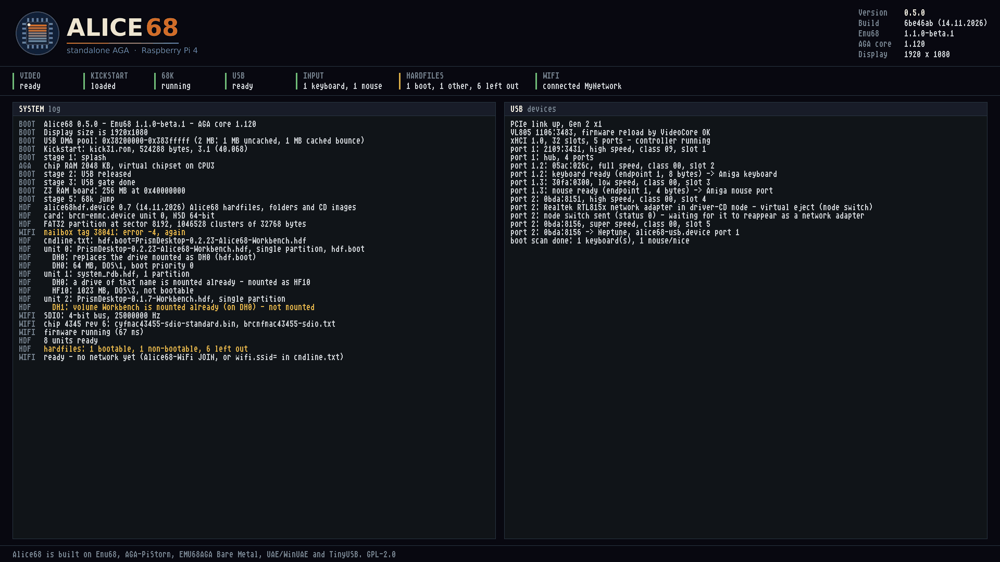

# Alice68

[](https://buymeacoffee.com/farsonic)

**A standalone AGA machine on a Raspberry Pi 4 (Pi 400 and CM4 untested): Workbench
and AGA software on a local HDMI display, with no PiStorm and no motherboard.**

Downloads: [Releases](https://github.com/farsonic/Alice68/releases) ·
What's new: [RELEASE-NOTES.md](RELEASE-NOTES.md) ·
Maintaining it with Claude: [docs/USING-CLAUDE.md](docs/USING-CLAUDE.md)

Alice68 is named after Alice, the AGA chip that succeeded Agnus, and the 68k that
Emu68 runs. It is a Pi 4 build of three projects, plus a Pi 4 USB stack of its own:

- **[Emu68](https://github.com/michalsc/Emu68)** by Michal Schulz: the 68k JIT
  (1.1.0-beta.1).
- **[AGA-PiStorm](https://astair86.itch.io/aga-pistorm-10-experimental-prototype)**
  1.120 by Astair86: the virtual Alice/Lisa/Paula, Copper and blitter, with output
  through the VideoCore VI and sound over HDMI.
- **[EMU68AGA Bare Metal](https://github.com/futureretrofusion/EMU68AGA-Bare-Metal)**
  by Future Retro Fusion: the standalone layer (virtual CIAs, ROM and ADF boot,
  Zorro III RAM, a TinyUSB host on the USB-C port).
- **Alice68's own additions:**
  - a kernel xHCI driver for the Pi 4's USB-A ports;
  - USB pass-through to the Neptune USB stack in AmigaOS;
  - a "virtual eject" for USB network dongles that start in CD mode;
  - Amiga hardfiles (`.hdf`) straight from the SD card, bootable and writable;
  - a boot splash with live logs.

Credits and licences: [THIRD_PARTY_NOTICES.md](THIRD_PARTY_NOTICES.md),
[LICENSE](LICENSE). Please report Alice68 problems here, not to the upstream projects.

> **Status:** tested on a Raspberry Pi 4. It boots to Workbench at 1080p. A USB-A
> keyboard and mouse work from power-on. A Realtek RTL8156 network adapter on Neptune
> passed traffic at about 108 Mbit/s. Hardfiles on the SD card mount, boot and take
> writes. Treat everything else as experimental.

## Quick start

1. Take a microSD card with a **FAT32** first partition (any Raspberry Pi OS card, or
   one formatted on a PC).
2. Copy the **Raspberry Pi firmware** onto it: `start4.elf`, `fixup4.dat` and
   `bcm2711-rpi-4-b.dtb` (`-400` for a Pi 400) from
   [raspberrypi/firmware](https://github.com/raspberrypi/firmware/tree/master/boot).
3. Copy everything in the release's **`boot/`** folder onto it: `kernel8.img`,
   `config.txt`, `cmdline.txt`, `floppy.txt` and the `overlays` folder.
4. Copy **your own** 512 KB A1200 Kickstart 3.x ROM onto it as **`kick31.rom`**, or
   change the name in `floppy.txt`. Kickstart is not included.
5. Plug a USB keyboard and mouse into the Pi's USB-A ports, connect HDMI0 (next to the
   USB-C power socket), and power on.

You get Kickstart's insert-disk screen. To get a Workbench, either put a hardfile on the
card (see [Hardfiles](#hardfiles-hdf-on-the-sd-card)), boot an ADF (see
[floppy.txt](#floppytxt-kickstart-and-adf)), or use Amiga partitions (MBR type `0x76`),
as with any Emu68 card.

The files in `boot/` work as they are. The next three sections explain what's in them
and what you can change.

## config.txt

The Raspberry Pi firmware reads `config.txt`. The default one, part by part:

```ini
[all]
kernel=kernel8.img        # Alice68
arm_64bit=1
disable_splash=1          # no rainbow screen
avoid_warnings=1
enable_uart=1
```
Leave these as they are.

**Display.** Alice68 uses **HDMI0**, the port next to the USB-C power socket.

```ini
hdmi_force_hotplug=1      # output even if the screen is detected late
hdmi_drive=2              # HDMI with sound (Paula is played over HDMI)
hdmi_group=1              # TV modes (CEA)
hdmi_mode=31              # 1080p50
```

| `hdmi_mode` | Picture |
|---|---|
| `31` | 1920×1080, 50 Hz (default: a PAL screen scales cleanly, Workbench text is sharp) |
| `16` | 1920×1080, 60 Hz |
| `19` | 1280×720, 50 Hz (if your screen prefers 720p) |
| `4` | 1280×720, 60 Hz |

Example: a 720p TV
```ini
hdmi_mode=19
```

**Kickstart.** It is named in its own file, so you can swap it without touching
`config.txt`:

```ini
include floppy.txt
```

**SD card for AmigaOS.** Emu68's `brcm-emmc.device` gives AmigaOS the card's Amiga
partitions (MBR type `0x76`, one drive each).

```ini
dtoverlay=emmc,unit0=rw
```

`unit0` is the **whole card**. Alice68's hardfile driver needs it, and it decides what
the hardfile driver may do:

| Setting | Effect |
|---|---|
| `dtoverlay=emmc,unit0=rw` | Hardfiles readable and writable (default) |
| `dtoverlay=emmc,unit0=ro` | Hardfiles read-only |
| `dtoverlay=emmc,unit0=off` | No hardfiles |
| `dtoverlay=emmc,unit0=rw,low_speed` | As the default, at 25 MHz: use this if your card gives errors (PFS3 reporting bad blocks, say) |

**Diagnostics (optional).** Emu68's on-screen HUD, off by default:

```ini
dtoverlay=diagnostic,hud
```

## floppy.txt: Kickstart and ADF

```ini
initramfs kick31.rom followkernel
```

The file name must match your ROM exactly, including case. Without a ROM the splash
stops with `FAIL: NO KICKSTART ROM LOADED`.

**Booting an ADF.** Join the ROM and a floppy image into one file on a PC, then name
that file here:

```bash
cat kick31.rom game.adf > kickadf.rom
```
(Windows: `copy /b kick31.rom+game.adf kickadf.rom`)

```ini
initramfs kickadf.rom followkernel
```

## cmdline.txt: Alice68's options

Everything goes on **one line**, separated by spaces. The default is:

```
aga.look=0 aga.scale=1
```

| Option | What it does |
|---|---|
| `aga.look=0` / `1` / `2` | Picture: sharp (default) / smooth / TV |
| `aga.scale=0` … `7` | Scaling: 0 4:3, 1 integer (default), 2 fill, 3 5:4, 4 16:9, 5 16:10, 6 21:9, 7 32:9 |
| `aga.nobootlog` | No log panels on the boot splash |
| `hdf.boot=NAME` | Boot from the hardfile `NAME` (see [Hardfiles](#hardfiles-hdf-on-the-sd-card)) |
| `hdf.readonly` | Hardfiles read-only |
| `hdf=off` | No hardfiles |
| `frf_usb=neptune` | Leave the USB-A ports to AmigaOS (rondoval's `xhci.device` + Neptune) instead of the kernel; the USB-C port then takes keyboard, mouse and pads (untested on a Pi 4) |
| `frf_usb.nomodeswitch` | Don't switch Realtek USB network dongles out of driver-CD mode |
| `wifi.ssid="NAME"` `wifi.psk="PASSWORD"` | Join this WiFi network at boot (see [WiFi](#wifi-new-not-yet-tested-on-a-pi)) |
| `wifi.country=GB` | Your country: the WiFi channels allowed |
| `wifi=off` | Leave the WiFi chip off |
| `eth=on` | Start the kernel's Ethernet at boot (it also starts when a stack opens `alice68net.device` unit 1) |
| `eth=off` | Keep the kernel off the Ethernet port (for rondoval's `genet.device`) |
| `net.trace=1` | Log every ICMP (ping) frame and the first dropped frames to the network log (Alice68-Monitor DUMP), kernel and alice68net.device |

Examples:

```
aga.look=0 aga.scale=1 hdf.boot=Workbench
```
boots from `Workbench.hdf`, with the default picture.

```
aga.look=2 aga.scale=0
```
gives a TV look, 4:3.

AGA-PiStorm's Chipset menu (`agaboot`) changes the picture at run time as well.

## The boot splash



The splash has five parts:

- **Header:** the Alice68 emblem and versions.
- **Status strip:** video, ROM, 68k, CPU1, USB, the input devices found, the
  hardfiles (how many boot, how many are mounted without booting, and how many were left
  out, in amber, with the reason in the SYSTEM panel) and the WiFi (connected, joining,
  no firmware, ...).
- **SYSTEM panel:** the kernel log.
- **USB panel:** the USB log.
- **Credits line.**

Failures show in red, so a photo of the screen is usually enough to diagnose a hang.
The splash keeps updating after the 68k starts - the hardfiles and the WiFi come in
then - and stops when AmigaOS puts its first picture up (or 30 s after the 68k started,
for a Workbench that opens straight on RTG), so nothing is drawn over AmigaOS's screen. `aga.nobootlog` in
`cmdline.txt` turns the log panels off. `tools/splash-preview/build.sh` renders the
splash on a PC with the kernel's own drawing code.

## USB

| Port | Default | With `frf_usb=neptune` |
|---|---|---|
| **USB-A ×4** (and the Pi 400 keyboard) | **The Alice68 kernel:** keyboards and mice go straight to the Amiga's keyboard and mouse port, from power-on and inside WHDLoad. Every other device (storage, network) is passed to **Neptune** in AmigaOS. | AmigaOS: rondoval's `xhci.device` + Neptune |
| **USB-C** (power socket) | not used | FRF's TinyUSB host in the kernel: keyboards, mice, pads, `usbmass.device` (tested by FRF on a Pi 3, untested on a Pi 4) |

A CM4's USB port is the USB-C controller, so on a CM4 use `frf_usb=neptune` (untested).

### Neptune on the USB-A ports (storage, network)

1. Install [Neptune](https://github.com/rondoval/neptune-usb-stack) 6.3 **without**
   `xhci.device`.
2. Copy `amiga/DEVS/USBHardware/alice68-usb.device` to `DEVS:USBHardware/` and
   `amiga/C/Alice68-USBLog` to `C:`.
3. Run `USBStart alice68-usb.device 0`.

Neptune sees an 8-port root hub, and every device the kernel doesn't keep for itself
appears on it. `Alice68-USBLog FOLLOW` tails the kernel's and the driver's USB logs in a
Shell.

- **Network adapters:** the Neptune class is the SANA-II driver. For `cdceth.usbclass`,
  give your TCP/IP stack `usbcdceth.device`, unit 0, as a bare name.
- **Virtual eject:** Realtek RTL815x adapters that start as a driver CD (`0bda:8151`)
  are switched to network mode by the kernel. `frf_usb.nomodeswitch` turns this off.
- **Pi's own Ethernet:** Alice68's Emu68 has the dcache extensions (the `dcache-range-ops`
  property), so take the **`-rangeops`** archive of rondoval's
  [driver stack](https://github.com/rondoval/emu68-driver-stack/releases)
  (`emu68-drivers-<ver>-rangeops.lha`). With Roadshow, AmiTCP, Miami or Riptide use its
  SANA-II `genet.device` **3.x**, in `DEVS:Networks/`: give the stack the full path
  `DEVS:Networks/genet.device`, unit 0. The 4.x `genet.device` is the netdev driver
  and works only with the archive's own TCP/IP stack (lwip-amiga), which gets closest to
  gigabit speed.
  `C:Alice68-NetCheck` (in `amiga/C`) prints what the driver reports, as text, on any
  AmigaOS: link rate, MAC address, packets and whether its interrupts reach AmigaOS.
  `Alice68-NetCheck WATCH` repeats the counters every second; `Alice68-NetCheck TEST`
  brings the interface up if no TCP/IP stack has, sends three broadcast test frames and
  says whether the link, the hardware and its interrupts work. It never loads a second
  copy of a driver a stack is using.
- **Leaving the USB-A ports to AmigaOS:** `frf_usb=neptune` in `cmdline.txt` keeps the
  kernel off them, so rondoval's `xhci.device` can drive them instead.

## WiFi and Ethernet: Alice68's network card (new, not yet tested on a Pi)

The **kernel** runs the Pi 4's built-in WiFi (the Cypress CYW43455 chip) and its Gigabit
Ethernet port (GENET) on CPU1, beside USB, and AmigaOS sees one network card with two
units: `alice68net.device` **unit 0 is the WiFi, unit 1 the Ethernet**. The driver speaks
lwip-amiga's `netdev` interface, which is faster than SANA-II (the stack and the driver call
each other directly): rondoval's **lwip-amiga** (the
[driver stack](https://github.com/rondoval/emu68-driver-stack/releases)'s archives) and
**Riptide** (**0.38 or later**: earlier versions hang after the first ping with a driver
that reports sent frames as promptly as this one) can use it; Roadshow, AmiTCP and Miami (SANA-II
only) cannot. The WiFi chip's own firmware does the WPA2 handshake (and WPA3 where the
firmware supports it).

**`Alice68-Network`** (in `C:`, or drag it to `SYS:Prefs`) is the settings window, in MUI
(3.8 or later) and in the look of Riptide's preferences: a **Status** page, then the
**Ethernet** pages (the link: rate, duplex, auto negotiation, what each side advertises,
flow control, link downs; the MAC address; on/off; and a **traffic** page with rates,
bytes, packets, drops and errors and a graph of the last minute) and the **WiFi** pages
(the connection; network name, password - dots unless Show is ticked - and country,
**Join and save**, Disconnect, on/off; **Networks**: Scan, and a click takes a network's
name; traffic). **Save** keeps the WiFi network in `ENVARC:alice68wifi.prefs` and the MAC
choices in `ENVARC:alice68net.prefs`. Without MUI, `Alice68-NetworkGT` is the simpler
GadTools window.

**Commodore's MAC prefix.** Tick *Use Commodore's OUI* on the Ethernet or WiFi page and
that unit's address starts with Commodore International's `00:80:10`, the last three bytes
staying the Pi's own. It changes at once (a TCP/IP stack already using the unit keeps the
old address until it opens it again) and, saved, from the next start on.

### WiFi

1. **Firmware**, on the SD card's FAT partition (where `kick31.rom` is), in a folder
   named **`WIFI`**. Alice68 does not include it. Take these from Raspberry Pi's
   [firmware-nonfree](https://github.com/RPi-Distro/firmware-nonfree) repository
   (`debian/added-firmware/`), or from `/lib/firmware/` on a Raspberry Pi OS card, names
   unchanged:
   - `cypress/cyfmac43455-sdio-standard.bin`
   - `cypress/cyfmac43455-sdio.clm_blob`
   - `brcm/brcmfmac43455-sdio.txt`

   (Compute Module 4: `brcm/brcmfmac43456-sdio.bin`, `.clm_blob` and `.txt` instead.)
   At boot `alice68hdf.device` reads them and hands them to the kernel, which starts the
   chip straight away: the splash's status strip shows **WIFI** and what it is doing.
2. **The network**, either in `cmdline.txt` (it then joins at boot, before AmigaOS):
   ```
   aga.look=0 aga.scale=1 wifi.ssid="MyNetwork" wifi.psk="my password" wifi.country=GB
   ```
   or from AmigaOS, after copying `amiga/C/Alice68-WiFi` to `C:`:
   ```
   Alice68-WiFi JOIN "MyNetwork" "my password" GB
   ```
   which also saves `ENV:` and `ENVARC:alice68wifi.prefs`; then `Alice68-WiFi RECONNECT`
   in `S:User-Startup` joins it at every boot. `wifi.country` (or the third word of JOIN)
   is your two-letter country code: the channels allowed. `wifi=off` in `cmdline.txt` keeps
   the chip off; `wifi.sdclock=` sets the SDIO clock (25000000 by default).
3. **The TCP/IP stack:** copy `amiga/DEVS/alice68net.device` to `DEVS:` and make a file
   `DEVS:NetInterfaces/wifi` with
   ```
   DEVICE=alice68net.device
   UNIT=0
   TYPE=NETDEV
   ADDRESS=DHCP
   ```
   (`AddNetInterface` in `S:Network-Startup` adds the files in that folder). lwip-amiga
   carries one interface at a time: WiFi or the Ethernet port, so give the other file
   `STATE=DOWN`.

### Ethernet (unit 1)

The kernel's Ethernet starts when a TCP/IP stack opens `alice68net.device` unit 1 (or at
boot with `eth=on` in `cmdline.txt`, so the splash's **LAN** field shows the link):
```
DEVICE=alice68net.device
UNIT=1
TYPE=NETDEV
ADDRESS=DHCP
```
in `DEVS:NetInterfaces/eth` for lwip-amiga. It then marks the port disabled in the device
tree for AmigaOS: **use either the kernel's Ethernet or rondoval's `genet.device`, not
both**. `eth=off` in `cmdline.txt` keeps the kernel off the port entirely, for
`genet.device`. It runs at 10, 100 or 1000 Mbit/s, as the link negotiates.

**Remove any other WiFi driver from AmigaOS's start-up** (WiFiPi.device and the like, in
`DEVS:NetInterfaces/`, `S:User-Startup` or a stack's own settings): the kernel drives the
chip now, and another driver resetting the same controller cuts it off. The kernel marks the
controller disabled in the device tree for AmigaOS; if something resets it anyway, the
splash and `Alice68-WiFi LOG` say "the WiFi controller was reset by someone else", and the
kernel starts the chip again 5 seconds later.

`Alice68-WiFi` on its own shows the state, the network, the signal and the counters;
`SCAN` lists the networks in range; `LOG` shows the kernel's WiFi log (the same lines are
on the splash and the serial log as `[WIFI] ...`) - send that if WiFi does not come up.
`DISCONNECT`, `OFF` (chip off) and `START` (on again) do what they say.

**When something hangs: `Alice68-Monitor`.** Start it first (`run Alice68-Monitor`): a
window at priority 21 that keeps updating while the mouse still moves. It shows what the
WiFi is doing now, every task with its state, the signals it waits for and a backtrace,
and the logs of the kernel, the network and the USB driver as they grow. Keys: space
pauses, `1`-`5` choose the log, `t` the size of the task list, `q` quits. The logs live on
the kernel's boards, which a 68k reset (Ctrl-Amiga-Amiga) does not clear: after a hang,
reset and run `Alice68-Monitor DUMP >RAM:dump.txt` to get what led up to it, including the
monitor's last task table.

Not supported: WEP, WPA-Enterprise, hidden networks only by name (they are tried when
not seen in a scan), access-point mode.

## Hardfiles (`.hdf`) on the SD card

Copy hardfiles onto the SD card's FAT boot partition, in the root folder or in a folder
named `HDF`. At start, `alice68hdf.device` (in Emu68's ROM board) finds every `*.hdf`
there and mounts it. It needs `dtoverlay=emmc,unit0=rw` in `config.txt`; use `unit0=ro`
for read-only.

- **Full-disk hardfiles** (WinUAE "hard drive" images, starting with an `RDSK` block):
  each partition is mounted with its own name and boot priority.
- **Single-partition hardfiles** (a filesystem from block 0, starting `DOS\x`): the
  layout is worked out from the file size and checked against the FFS root block. The
  partition is mounted as the first free `DH0`, `DH1`, and so on.
- **Writing:** writes go straight into the file's own clusters on the card and nowhere
  else. The FAT itself is never changed, so the file keeps its size and place. Back up
  hardfiles you care about before writing to them here.
- **Filesystems:** FFS (`DOS\0` to `DOS\7`) comes from Kickstart. PFS3, SFS and other
  filesystems stored in a hardfile's RDB are loaded from it (unless a newer version is
  loaded already) and offered to other drives through `FileSystem.resource` too.
- **One volume, one drive:** the driver reads each FFS partition's volume name. A
  hardfile partition with the name of a volume already mounted - on the SD card's own
  Amiga partitions or on another hardfile - is left out, because AmigaOS mixes up two
  volumes of the same name. The hardfile chosen with `hdf.boot=` wins instead: the
  other drive is not mounted that boot.
- **On the splash:** the driver's lines (`[alice68hdf] ...`) appear in the splash's
  SYSTEM panel and the serial log, so you can see what was mounted while it boots.

**Every hardfile is mounted, and none of them boots** - your SD card boots as before.
To boot from one of them, name it in `cmdline.txt` (one line):

```
hdf.boot=Workbench
```

That hardfile boots, and the others stay mounted. `Workbench` matches `Workbench.hdf`
(any case, `.hdf` optional); write a space in the file name as `_`
(`hdf.boot=Workbench_3.1`). If one of its partitions has the name of a drive that's
already mounted (your SD card's `DH0`, say), it takes that name and the SD card drive is
not mounted for this boot, so `DH0:` is the hardfile. Any other hardfile partition
whose name is taken is mounted as `HF<unit><partition>` (e.g. `HF10`) instead.

| Other options | Effect |
|---|---|
| `hdf.readonly` | No writes: the hardfiles show as write-protected. |
| `hdf=off` | No hardfiles at all. |

Limits: FAT32 holds files up to 4 GB. Copy files only while the Pi is off. `C:Alice68-HDF`
lists the hardfiles found and the driver's log, including why anything was left out.
`tools/hdf-test/run.sh` runs the tests on a PC.

## Serial log

Connect a **3.3 V** USB-TTL adapter's RX to **pin 8** (GPIO 14) and GND to **pin 6**,
then open a terminal at **921600 8N1**:

```bash
picocom -b 921600 /dev/ttyUSB0
```

## Build

Ubuntu 24.04. You need:

- `build-essential cmake ninja-build device-tree-compiler xxd`
- `gcc-14-powerpc-linux-gnu g++-14-powerpc-linux-gnu`
- the Arm GNU Toolchain 15.x for `aarch64_be-none-linux-gnu`
- for the 68k tools: `gcc-m68k-linux-gnu`

Fetch the submodules first:

```bash
git submodule update --init
```

Build the kernel (output: `dist/pi4/kernel8.img`):

```bash
ARM_GNU_TOOLCHAIN=$HOME/toolchains/arm-gnu-toolchain-15.2.rel1-x86_64-aarch64_be-none-linux-gnu \
  bash tools/build-emu68aga-pi4.sh
```

Build the 68k parts, `alice68-usb.device`, `Alice68-USBLog`, `alice68hdf.device` and
`Alice68-HDF` (output: `amiga/out/`):

```bash
bash amiga/build.sh
```

`FRF_USB=OFF` builds a kernel without the ARM-side USB hosts. `third_party/Emu68` is
Emu68 at upstream commit `0ba3a89`, with AGA-PiStorm's, FRF's and Alice68's changes;
`docs/PROVENANCE.md` says exactly which.

The original AGA-PiStorm README and licence are in
[docs/AGA-PISTORM-README.md](docs/AGA-PISTORM-README.md) and
[docs/AGA-PISTORM-LICENSE.txt](docs/AGA-PISTORM-LICENSE.txt).

## Support

Alice68 is a hobby project. If it's useful to you, you can
[buy me a coffee](https://buymeacoffee.com/farsonic). Thank you!

The credit for the emulation itself belongs to Emu68, AGA-PiStorm, EMU68AGA Bare Metal
and their contributors (see [THIRD_PARTY_NOTICES.md](THIRD_PARTY_NOTICES.md)).
